# ProFo 房地产翻新与销售管理系统

<p align="center">
  
  
  
  
  
  
  
  
  
  
</p>

<p align="center">
  <b>轻量级、本地化、高性能的房产数据中心</b><br/>
  <sub>B 端 ERP + C 端营销站 + 微信小程序 · 四层领域架构 · 楼盘字典 · 获客归因 · JWT + API Key 双认证</sub>
</p>

> **当前状态（2026-10）**：应用版本 `0.9.0`；后端 73 张数据表、274 个 API 路径、77 个幂等启动迁移；前端 Next.js 16 App Router；微信小程序「美房宝」已覆盖员工展业与 C 端客户双场景。

---

## 📋 目录

1. [项目概览](#-项目概览)
2. [技术架构](#-技术架构)
3. [快速开始](#-快速开始)
4. [配置说明](#-配置说明)
5. [功能模块](#-功能模块)
6. [API 接口](#-api-接口)
7. [数据库设计](#-数据库设计)
8. [核心业务流程](#-核心业务流程)
9. [部署指南](#-部署指南)
10. [数据迁移](#-数据迁移)
11. [开发规范](#-开发规范)
12. [测试与验证](#-测试与验证)
13. [常见问题](#-常见问题)
14. [项目结构](#-项目结构)
15. [文档索引](#-文档索引)

---

## 🏠 项目概览

### 项目背景

ProFo 是一个面向房地产翻新与销售业务的全流程管理系统，围绕「**获客 → 线索 → 项目 → 装修 → 在售 → 成交 → 结算**」这条主链路，提供**三端一体**的数据与作业平台：

| 端 | 形态 | 使用对象 | 主要入口 |
|----|------|---------|---------|
| **B 端后台** | Next.js Web | 管理员 / 运营 / 内部员工 | `/admin/**` |
| **C 端公开站** | Next.js Web | 买房客户 / 卖房业主 | `/`、`/projects`、`/valuation`、`/my` |
| **微信小程序「美房宝」** | 原生微信小程序（TS） | 员工展业 + C 端客户 | 微信客户端 |

三端共用同一套 FastAPI 后端与 PostgreSQL 数据源；小程序与 Web 前端各自从后端 OpenAPI 独立生成类型，互不依赖。

### 业务闭环

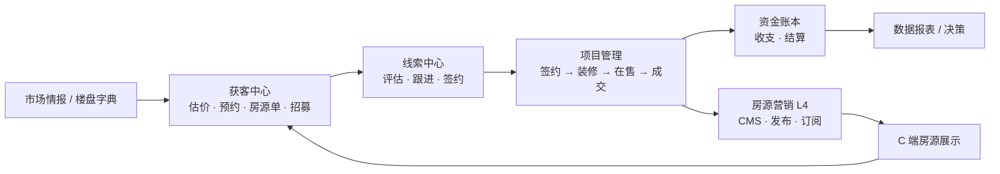

### 功能地图（按后台导航）

| 分组 | 模块 | 后台入口 | 核心能力 |
|------|------|---------|---------|
| — | 工作台 | `/admin` | 今日数据概览、快捷入口、市场监控模块 |
| 业务 | 房源管理 | `/admin/properties` | 房源列表、批量上传、房源治理（旧入口重定向字典） |
| 业务 | **楼盘字典** | `/admin/building-dictionary` | 小区 → 楼栋 → 楼层 → 户室四级字典、批量导入、审核池、合并/解除合并、户型图库、业务绑定 |
| 业务 | 线索中心 | `/admin/leads` | 线索漏斗、待评估队列、跟进、价格历史、评估历史、图片、字典绑定 |
| 业务 | 项目管理 | `/admin/projects` | 合同/文书/装修/销售/带看/出价/面谈/钥匙/现金流 |
| 业务 | 项目待办 | `/admin/projects/todo-board` | 规则引擎实时待办看板 + 阈值配置 |
| 业务 | 房源营销 | `/admin/marketing` | L4 营销房源 CMS、媒体拖拽排序、调价、发布、订阅通知 |
| 增长 | **获客中心** | `/admin/growth-center` | 4 链路获客总览、统一线索、漏斗对比、员工榜、活动配置 |
| 增长 | 数据报表 | `/admin/reports` | 商圈分析、小区分析、成交趋势、户型/楼层分布、对比 |
| 财务 | 资金账本 | `/admin/ledger` | 项目流水、统计、应收应付、结算、Excel 导出 |
| 财务 | 跟投管理 | `/admin/investments` | 跟投记录、投资方、分配比例调整、结算、复制、导出 |
| 财务 | 科目管理 | `/admin/ledger/subjects` | 财务科目字典（按业务模式过滤） |
| 系统 | 用户管理 | `/admin/users` | 用户、角色、权限点配置 |
| 系统 | 审计日志 | `/admin/audit-logs` | 全局操作审计（用户/模块/动作/时间） |
| 系统 | 设置 | `/admin/settings` | API Key、订阅消息模板 |
| C 端 | 公开站 | `(c)` 路由组 | 首页、房源、房源详情、估价、我的、个人中心、登录注册、关于/联系 |
| 小程序 | 美房宝 | `miniapp/` | 房源、估价、预约、客户、项目、带看、装修、账本、钥匙、房源单、招募、计算器 |

### 当前状态速览

- ✅ **已实现核心域**：房源/字典、线索、项目、财务、营销、报表、获客、钥匙、权限审计。
- ✅ **三端可用**：B 端后台、C 端公开站、微信小程序。
- ✅ **数据资产**：楼盘字典已具备「小区/楼栋/户室」结构化数据能力，支持 zip/txt 批量导入与审核池治理。
- ✅ **安全基线**：JWT + Refresh Token + API Key、细粒度权限、Fernet 字段加密、CSRF、限流、文件类型嗅探、审计日志。
- ✅ **工程质量**：后端 77 个幂等启动迁移 + pytest/E2E；前端 Playwright E2E；小程序 Vitest。

---

## 🏗️ 技术架构

### 系统整体架构

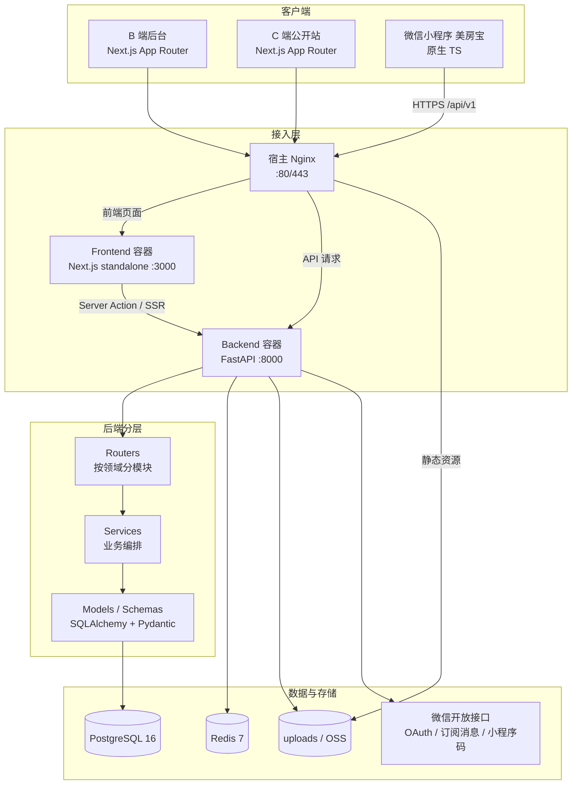

### 四层业务领域 + 数据底座

系统在原有「L1 市场情报 → L2 线索 → L3 项目 → L4 营销」写时复制链路之外，新增**楼盘字典**作为结构化地址底座，并新增**获客中心**作为跨链路只读聚合层。

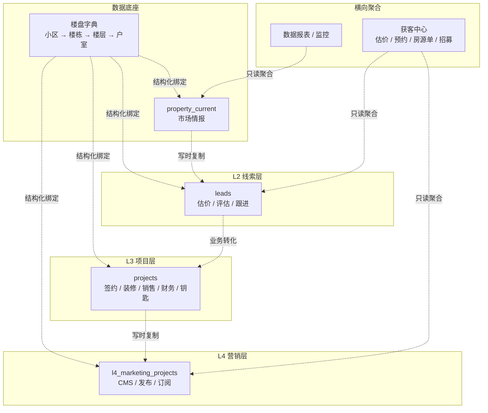

> 「写时复制」指下游单据创建时复制上游快照字段，后续互不影响；楼盘字典通过 `dictionary-link` 端点对存量项目/线索/营销/房源建立结构化引用（非强制绑定，未绑定单据零影响）。

### 技术栈

#### 前端（`frontend/`）

| 技术 | 版本 | 用途 |
|------|------|------|
| Next.js | 16.3.0 | App Router、Server Actions、standalone 输出、Proxy（原 middleware） |
| React | 19.2.1 | UI 库，React Compiler 优化 |
| TypeScript | 5.9.3 | 类型安全 |
| TailwindCSS | 4.3 | 原子化 CSS |
| Radix UI / shadcn | 1.4.3 | 无障碍 UI 组件 |
| SWR | 2.4.1 | 客户端数据获取与缓存 |
| nuqs | 2.8.6 | URL 查询参数状态 |
| React Hook Form + Zod | 7.71 / 4.3 | 表单状态与校验 |
| dnd-kit | 6.3 / 10.0 | 营销照片拖拽排序 |
| Recharts | 3.7 | 图表可视化 |
| @tanstack/react-table | 8.21 | 复杂表格 |
| framer-motion | 12.38 | 动画 |
| sonner | 2.0 | Toast |
| openapi-fetch + openapi-typescript | 0.15 / 7.10 | 类型安全 API 客户端 |
| Vitest + Playwright | 3.2 / 1.59 | 单元测试 + E2E |

#### 微信小程序（`miniapp/`）

| 技术 | 说明 |
|------|------|
| 原生微信小程序 | WXML / WXSS / TypeScript，无跨端框架依赖 |
| 微信基础库 | 3.16.2 |
| 分包 | 账本 / 带看 / 装修 / 分析 / 社区分析 / 钥匙 / 协议 / 绑定账号 |
| 类型 | `openapi-typescript` 从后端 `/openapi.json` 独立生成 |
| 测试 | Vitest（工具函数 + 页面逻辑） |

#### 后端（`backend/`）

| 技术 | 版本 | 用途 |
|------|------|------|
| FastAPI | ≥ 0.104 | Web 框架 |
| SQLAlchemy | ≥ 2.0 | ORM（`Mapped[]` + `mapped_column()`） |
| Pydantic | v2 | Schema 与校验 |
| pydantic-settings | ≥ 2.14 | 环境变量配置 |
| PostgreSQL | 16 | 主数据库 |
| psycopg[binary] | ≥ 3.1 | PostgreSQL 驱动 |
| Redis | 7 | 限流 / 缓存 / 跨 worker 协调 |
| slowapi | ≥ 0.1.9 | 接口限流 |
| python-jose | ≥ 3.3 | JWT |
| bcrypt / pwdlib | ≥ 4.0 / ≥ 0.2 | 密码哈希 |
| cryptography (Fernet) | — | 敏感字段加密 |
| oss2 | ≥ 2.18 | 阿里云 OSS |
| httpx | ≥ 0.25 | 微信接口调用 |
| openpyxl | ≥ 3.1 | Excel 导出 |
| filetype + Pillow | — | 上传嗅探 / 图片处理 |
| uv | — | 包管理与虚拟环境 |

> **未使用 Alembic**：Schema 变更统一通过 `backend/migrations/` 的幂等启动迁移管理，应用启动时由 `lifespan` 自动执行。

### 前端架构

#### 双路由组

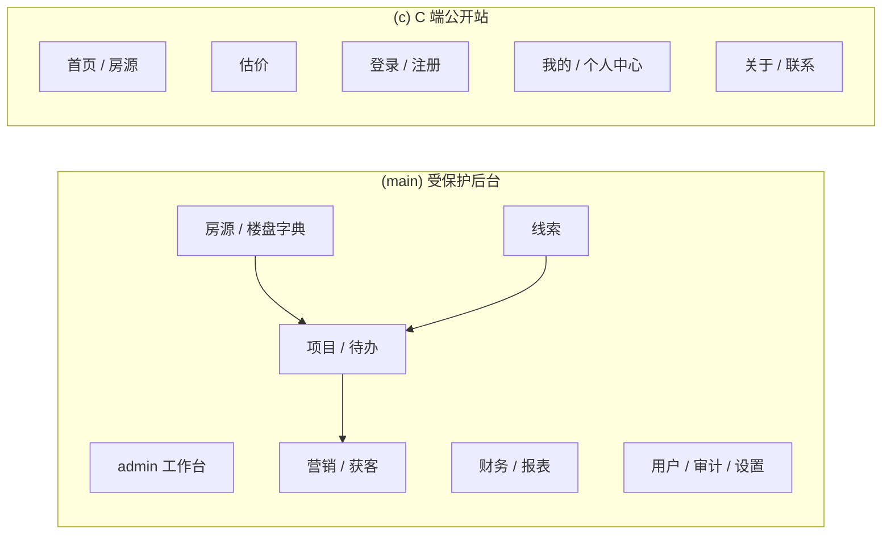

- **`(main)/layout.tsx`** — 后台鉴权布局，未登录跳转 `/admin/login`。
- **`(c)/layout.tsx`** — C 端公开布局，C 端受保护路径（`/valuation`、`/leads`、`/my`、`/profile`）由 `proxy.ts` 统一拦截。
- **`proxy.ts`** — Next.js 16 Proxy：域名分流（`ADMIN_DOMAINS`）、C 端/admin 双 Auth 会话解析、Token 自动刷新、CSP（Report-Only）、`x-pathname`/`x-nonce` 注入。

#### 双认证实例

| 实例 | 文件 | Cookie | 用途 |
|------|------|--------|------|
| `auth` | `src/auth.ts` | `c_access_token` / `c_refresh_token` | C 端客户登录 |
| `adminAuth` | `src/admin-auth.ts` | `access_token` / `refresh_token` | B 端后台登录 |

两者都基于 `src/lib/auth/` 内部 Auth 库，各自维护 adapter、Cookie 名与刷新策略；后端通过 `aud`（audience）区分两类 Token，业务接口分别校验，避免越权。

#### 双 API 客户端

| 客户端 | 文件 | 场景 | 特性 |
|--------|------|------|------|
| `fetchClient()` | `lib/api-server.ts` | Server Components / Server Actions | 直接读 Cookie；401 自动刷新；`NEXT_REDIRECT` 守卫 |
| `client` | `lib/api-client.ts` | Client Components | `credentials: "include"`；401 跳登录 |
| `api-c` | `lib/api-c/` | C 端页面 | C 端 Token 与 SWR fetcher |

> **Docker 部署关键点**：Server Action 在 frontend 容器内执行，`127.0.0.1:8000` 会指向容器自身。`docker-compose.yml` 已通过 `SERVER_API_URL=http://backend:8000` 让 SSR/Server Action 直连 backend 容器。
>
> 开发环境通过 `next.config.ts` 的 `rewrites` 将 `/api/*`、`/static/*` 代理到 `http://127.0.0.1:8000`，使前后端同域，Cookie 可正常发送。

### 小程序架构

- **工程独立**：`miniapp/` 不并入前端 monorepo，使用微信开发者工具直接编译 TS。
- **身份模型**：一条 `User` 可持有多个角色（`user_roles`），员工账号可同时具备后台身份与 C 端身份；小程序同时保存后台 Token（内部功能）与 C 端 Token（`/public/*` 客户功能），按页面场景选用，避免 Token 混用。
- **API 基址**：`miniapp/utils/config.ts` 按 `envVersion`（develop/trial/release）切换；默认生产域名，联调时改为局域网后端地址。
- **类型同步**：`pnpm gen-api` 生成 `miniapp/types/api-types.d.ts`；`pnpm gen-env` 从根 `.env` 生成 `miniapp/utils/env.ts`（OSS 基址 / 水印样式）。
- **页面分包**：主包承载 C 端高频页（房源列表/详情、估价、我的、服务），内部员工功能与重资源页进入分包，控制主包体积。

### 后端架构

#### 服务分层（Router → Service → Model）

```
backend/
├── routers/                    # API 路由层（薄，仅参数校验/依赖注入）
│   ├── common/                 # 通用（files / push / upload）
│   ├── market/                 # 市场情报（properties / communities / 小区图片）
│   ├── property/               # 楼盘字典（building_dict / dictionary_link）
│   ├── leads/                  # 线索（core / leads / followups / prices / evaluations）
│   ├── projects/               # 项目（core / documents / renovation / sales / keys）
│   ├── finance/                # 资金账本 + 科目（ledger / subjects）
│   ├── investment/             # 跟投管理
│   ├── marketing/              # 营销（projects / import_）
│   ├── growth_center/          # 获客中心（聚合只读 + 统一线索）
│   ├── recruit/                # 区域伙伴招募（admin / public）
│   ├── keys/                   # 钥匙分享（员工侧）
│   ├── monitor/                # 市场监控
│   ├── reports/                # 数据报表（communities / market）
│   ├── public/                 # C 端公开接口（auth / users / projects / marketing / leads / bookings /
│   │                           #   property_sheets / customers / valuations / communities / files / key_shares）
│   └── system/                 # 系统（auth / users / roles / permissions / operation_logs / subscribe_templates）
├── services/                   # 业务逻辑层（按领域模块化）
│   ├── market/                 # 房源查询 / 导入 / 小区合并 / CSV 解析 / 导入任务
│   ├── property/               # 楼盘字典：解析 / 导入 / 读取 / 写入 / 审核 / 回填 / 归属 / 绑定
│   ├── leads/                  # 线索核心 / 跟进 / 价格 / 评估 / 归因埋点 / 通知
│   ├── projects/               # Facade + core / renovation / sales / keys / key_shares / todo_board
│   │   ├── finance/            # 资金账本（base / ledger / records / receivable_payable / settlement / statistics）
│   │   └── internal/           # builder / contract_number / creator / documents / owners / query / state / updater
│   ├── investment/             # 跟投管理（base / records / investors / settlement / exporter）
│   ├── marketing/              # 营销项目 / 媒体 / 导入 / 公开 / 订阅 / 通知 / 聚合
│   ├── growth_center/          # 获客总览 / 漏斗 / 统一线索 / 我的客户 / 员工 / 身份
│   ├── recruit/                # 招募活动 / 线索 / 漏斗 / 归因 / 小程序码
│   ├── property_sheet/         # 房源单（多房源分享）
│   ├── monitor/                # 监控服务 + neighborhood
│   ├── reports/                # 报表聚合（aggregations / bucketing / cache / dictionaries / filter_builder）
│   ├── system/                 # auth / user / role / api_key / permission / operation_log / subscribe_templates
│   └── utils/                  # 日期解析 / 推荐人 / 分享统计
├── models/                     # 数据模型层（按领域模块化）
│   ├── common/                 # Base / BaseModel / 枚举 / encrypted 字段
│   ├── property/               # Community / CommunityAlias / CommunityImage / PropertyCurrent /
│   │   │                       #   PropertyHistory / PropertyMedia / BdBuilding / BdRoom / BdPending* / BdImportTask
│   ├── lead/                   # Lead / LeadFollowUp / LeadPriceHistory / LeadEvalHistory /
│   │   │                       #   ValuationVisit / ValuationShareEvent
│   ├── project/                # Project + 子模型（合同/文书/业主/销售/跟进/互动/财务/日志/装修/照片）+ FinanceSubject
│   ├── investment/             # Investment / Investor / ReturnAdjustment / InvestmentLog
│   ├── marketing/              # L4MarketingProject / Media / Subscription / NotifyLog / PriceChange /
│   │   │                       #   ProjectBooking / ProjectVisit / ProjectShareEvent / PropertyShareSheet*
│   ├── key/                    # ProjectKey / ProjectNormalKey / KeyShare / KeyShareView / KeyAuditLog
│   ├── recruit/                # RecruitCampaign / RecruitLead / RecruitVisit / RecruitShareEvent / RecruitQRScene
│   ├── growth_center/          # CustomerFollowUp
│   ├── system/                 # FailedRecord / PropertyImportTask / WeChatOAuthState / WeChatTempCode /
│   │   │                       #   OperationLog / SystemConfig
│   └── user/                   # User / Role / UserRole / ApiKey / RefreshToken / Permission / RolePermission
├── schemas/                    # Pydantic Schema（*Create / *Update / *Response / *Filter / *Request）
├── dependencies/               # FastAPI 依赖（auth / common / projects / keys，含 *PermDep）
├── utils/                      # auth / crypto / csv_exporter / file_security / formatters / jwt_validator /
│   │                           #   mask / image_processing / redis_client / storage / security_logger /
│   │                           #   building_dict / floor_plan / time_windows / query_params
├── constants/                  # 业务常量（文书模板 / 角色码 / 待办规则）
├── migrations/                 # 启动时幂等迁移（43 个文件 / 77 个迁移函数）
├── scripts/                    # 一次性脚本（图片分类等）
├── tests/                      # pytest + E2E（tests/e2e）
├── main.py                     # 应用入口（lifespan / 中间件 / 健康检查 / OpenAPI tags）
├── db.py                       # SQLAlchemy 引擎 + 会话工厂 + init_db()
├── settings.py                 # Pydantic Settings（app v0.9.0）
├── error_handlers.py           # 全局异常处理器
├── init_admin.py               # 初始化角色与管理员
├── init_db.py                  # 建表脚本
└── conftest.py                 # pytest 配置（PostgreSQL + SAVEPOINT 隔离）
```

#### 关键设计模式

- **依赖注入**：`DbSessionDep`、`CurrentUserDep`、`CurrentAdminUserDep`、`PaginationDep`；权限依赖统一命名 `[Resource][Action]PermDep`（如 `ProjectReadPermDep`），对应权限码 `[resource]:[action]`。
- **权限系统**：`permissions` 动态权限点 + `role_permissions` 角色授权 + `operation_logs` 审计；权限变更触发 `token_version` 递增强制旧 Token 失效；内置角色受 `roles.is_system` 保护；权限点带 `risk_level` 风险分级。
- **业务身份双通道**：列表页看权限码，项目详情等场景叠加「业务负责人 / 销售团队成员 / 对接人」身份校验，Service 层二次防御。
- **服务异常**：Service 层抛 `ServiceException` / `AuthenticationError` / `ResourceNotFoundError` / `ValidationError` / `BusinessLogicError`，全局 handler 统一捕获；**禁止在 Service 层抛 `HTTPException`**。
- **响应格式**：成功直接返回 Pydantic 模型；分页统一 `PaginatedResponse[T]`；错误统一 `{"code": ≠0, "message": "..."}`。
- **逻辑外键**：关联使用 `user_id`（String(36)）/ `project_id`（UUID）等软外键，数据库层不建 FK 约束，级联与关联完整性由 Service 编排。
- **加密字段**：`models/common/encrypted.py` 的 `EncryptedString` 自动加密身份证 / 手机号 / 银行卡 / 微信会话密钥；`phone_hash` 承载唯一约束。
- **时区**：业务时间列统一 `DateTime(timezone=True)`（`timestamptz`），纯日期用 `Date`；启动迁移自动修复旧列类型。
- **CSRF 防护**：纯 Cookie 认证的非安全方法必须携带 `X-Requested-With`；Bearer / API Key 认证与 Server Action 不受影响。
- **请求追踪**：`X-Request-ID` 中间件（白名单校验 + UUID 兜底），日志格式注入 `request_id`，同时落盘 `backend/logs/app.log`。
- **限流**：`utils/common.py` 的 `RateLimits` 集中管理；`_get_client_ip` 按 `TRUSTED_PROXIES`（支持 CIDR）从右向左解析 XFF，防伪造。
- **响应压缩**：自定义 `GZipExemptPrefixMiddleware` 对 `/static` 豁免，避免破坏视频 Range 请求。
- **存储抽象**：`storage_backend=local|oss`；上传/删除/URL 生成统一走 `utils/storage.py`。

---

## 🚀 快速开始

### 前置条件

| 场景 | 需要 |
|------|------|
| Docker 一键部署 | Docker Engine + Docker Compose v2 |
| 本地开发 | Node.js ≥ 20、pnpm ≥ 9、Python ≥ 3.10、uv、PostgreSQL + Redis（或 Docker） |
| 小程序 | 微信开发者工具、微信小程序 AppID |

### 方式一：Docker 一键启动（推荐体验）

```bash
# 1. 生成密钥并初始化 .env（自动从 .env.docker.example 创建并填入随机密钥）
./scripts/init-env.sh
#    自动生成并写入：
#    - POSTGRES_PASSWORD  数据库强密码（24 位字母数字）
#    - REDIS_PASSWORD     Redis 强密码
#    - JWT_SECRET_KEY     JWT 签名密钥（64 位 hex）
#    - ENCRYPTION_KEY     Fernet 加密密钥
#    - DATABASE_URL / REDIS_URL 自动同步
# 查看完整密钥: ./scripts/init-env.sh --show
# 强制重新生成: ./scripts/init-env.sh --force

# 2. 构建并启动全部服务
docker compose up -d --build

# 3. 首次部署：建表 + 创建管理员（打印临时密码）
./scripts/setup.sh --docker
```

启动后：

- 前端：`http://localhost/`（需宿主 nginx 反代到 `127.0.0.1:3000`）
- 后端 API：`http://127.0.0.1:8000/api/v1`
- 健康检查：`curl http://127.0.0.1:8000/health` → `{"status":"healthy","database":"connected"}`
- API 文档：`http://127.0.0.1:8000/docs`（仅 `DEBUG=true` 时暴露）

> 当前 compose 不包含 nginx 容器，使用宿主 nginx / Caddy / Traefik 反代到 `127.0.0.1:3000`（前端）与 `127.0.0.1:8000`（后端）。

### 方式二：本地开发（推荐日常开发）

```bash
# 1. 生成 .env（首次）
./scripts/init-env.sh

# 2. 仅启动 PostgreSQL + Redis（Docker）
./dev-start.sh db
# 或手动：
# docker compose -f docker-compose.yml -f docker-compose.dev.yml up -d db redis

# 3. 初始化数据库 + 管理员
./scripts/setup.sh
# 支持：
#   --admin-password 'P@ssw0rd'   指定管理员密码
#   --reset-admin                 重置管理员密码
#   --sync-db-password            认证失败时同步 DB 密码为 .env 值（保留数据）
#   --fresh-db                    删除数据卷重建（清空数据）
#   --skip-db                     跳过 DB 启动
#   --help                        查看帮助

# 4. 启动前后端（自动启动 DB + uvicorn --reload + next dev）
./dev-start.sh
```

手动分别启动：

```bash
# 后端
cd backend
uv venv && uv sync
uv run uvicorn main:app --reload --host 0.0.0.0 --port 8000

# 前端
cd frontend
pnpm install
cp .env.example .env.local
pnpm dev
```

默认地址：

- 后端：`http://127.0.0.1:8000`
- 前端：`http://localhost:3000`
- 文档：`http://127.0.0.1:8000/docs`

`dev-start.sh` 子命令：`up`（默认，启动全部）、`db`（仅启动 PostgreSQL + Redis）、`stop`、`status`、`logs`、`down`。

### 方式三：微信小程序开发

```bash
cd miniapp
pnpm install

# 从后端重新生成 API 类型（后端需运行）
pnpm gen-api

# 从仓库根 .env 生成 miniapp/utils/env.ts（需 OSS_PUBLIC_BASE_URL / OSS_WATERMARK_STYLE）
pnpm gen-env

# 类型检查 / 单元测试
pnpm tsc
pnpm test
```

然后用**微信开发者工具**导入 `miniapp/` 目录（`project.config.json` 已配置 TypeScript 编译）：

- 本地联调：修改 `miniapp/utils/config.ts` 中的 `develop` 地址为局域网后端，例如 `http://192.168.x.x:8000/api/v1`；提交前切回线上域名。
- 首次导入后执行微信开发者工具「工具 → 构建 npm」（项目依赖 `@babel/runtime`，`project.config.json` 已配置 npm 目录）。
- 线上域名：需在微信公众平台「开发管理 → 服务器域名」配置 `https://fangmengchina.com` 为 request 合法域名。
- AppID：`project.config.json` 中的 `appid` 已配置；团队协作请使用 `project.private.config.json` 覆盖个人设置。

### 默认账号与密码

- 后台登录：`http://localhost:3000/admin/login`
- C 端登录：`http://localhost:3000/login`
- 管理员用户名：`admin`
- 密码：由 `scripts/setup.sh` / `init_admin.py` 生成并打印，首次登录强制修改。

> 账号密码从环境变量读取，**严禁硬编码提交**。E2E 使用 `E2E_ADMIN_USER` / `E2E_ADMIN_PASSWORD`。

---

## ⚙️ 配置说明

### 后端环境变量（根目录 `.env`）

模板见 [`.env.docker.example`](.env.docker.example)，由 `docker-compose.yml` 的 `env_file` 注入 backend 容器。

#### 必填

| 变量 | 说明 |
|------|------|
| `POSTGRES_USER` | PostgreSQL 用户名（默认 `profo`） |
| `POSTGRES_PASSWORD` | PostgreSQL 强密码（**仅字母数字**，避免 `# @ : /` 等 URL 保留字符） |
| `POSTGRES_DB` | PostgreSQL 数据库名（默认 `profo`） |
| `REDIS_PASSWORD` | Redis 密码（**生产必须强密码**；空值会拒绝启动） |
| `JWT_SECRET_KEY` | JWT 签名密钥（`openssl rand -hex 32`） |
| `ENCRYPTION_KEY` | Fernet 对称加密密钥（**生成后不可更改**，否则已加密数据无法解密） |
| `WECHAT_APPID` | 微信 AppID（不使用微信登录也需填占位符） |
| `WECHAT_SECRET` | 微信 AppSecret |

#### 数据库与基础设施

| 变量 | 默认 | 说明 |
|------|------|------|
| `DATABASE_URL` | — | 连接串；compose 会用 `${POSTGRES_*}` 重新拼装指向 `db:5432` |
| `REDIS_URL` | — | 连接串；compose 会拼装为 `redis://:${REDIS_PASSWORD}@redis:6379/0` |
| `STORAGE_BACKEND` | `local` | `local`=本地文件系统，`oss`=阿里云 OSS |
| `OSS_ACCESS_KEY_ID` | — | OSS AccessKey（`oss` 模式必填，建议 RAM 子账号） |
| `OSS_ACCESS_KEY_SECRET` | — | OSS AccessKey Secret |
| `OSS_BUCKET_NAME` | — | Bucket 名称 |
| `OSS_ENDPOINT` | — | OSS Endpoint（ECS 同地域用内网 endpoint 免流量费） |
| `OSS_PUBLIC_BASE_URL` | — | OSS 公网/CDN 访问基址（无尾斜杠） |
| `OSS_WATERMARK_STYLE` | — | OSS 图片处理样式名（仅小程序 `pnpm gen-env` 读取，后端不使用） |

#### 认证与安全

| 变量 | 默认 | 说明 |
|------|------|------|
| `JWT_ACCESS_TOKEN_EXPIRE_MINUTES` | `30` | 访问令牌过期时间 |
| `JWT_REFRESH_TOKEN_EXPIRE_DAYS` | `7` | 刷新令牌过期时间 |
| `JWT_KEY_ROTATION_ENABLED` | `false` | 是否启用密钥轮换 |
| `JWT_SECRET_KEY_OLD` | — | 旧密钥（轮换过渡期） |
| `CORS_ORIGINS` | `[]` | 允许的跨域来源（同域部署留空；JSON 数组或逗号分隔） |
| `TRUSTED_PROXIES` | `["127.0.0.1","::1"]` | 可信代理 IP/CIDR；Docker 部署需补 `172.16.0.0/12` |
| `API_PREFIX` | `/api` | API 前缀 |
| `DEBUG` | `false` | 调试模式；为 `false` 时不暴露 `/docs` `/redoc` `/openapi.json` |

#### 上传与分页

| 变量 | 默认 | 说明 |
|------|------|------|
| `UPLOAD_DIR` | `/app/static/uploads` | 上传目录（Docker 路径；本地默认 `backend/static/uploads`） |
| `MAX_UPLOAD_SIZE` | `524288000` | 上传大小上限（500 MB，支持视频） |
| `DEFAULT_PAGE_SIZE` | `50` | 默认分页大小 |
| `MAX_PAGE_SIZE` | `200` | 单页上限 |

#### 微信与订阅消息（可选）

| 变量 | 说明 |
|------|------|
| `WECHAT_REDIRECT_URI` | 微信 OAuth 回调地址 |
| `FRONTEND_URL` | 前端 URL（微信回调重定向等） |
| `WECHAT_RECRUIT_LEAD_TEMPLATE_ID` | 招募新线索订阅模板 ID（空 = 关闭） |
| `WECHAT_VALUATION_PRICE_TEMPLATE_ID` | 估价授权价变更订阅模板 ID（空 = 关闭） |
| `WECHAT_CUSTOMER_LEAD_TEMPLATE_ID` | 「我的客户」新线索订阅模板 ID（空 = 关闭） |
| `WECHAT_PROJECT_NEW_TEMPLATE_ID` | 房源上新订阅模板 ID（DB 配置优先，env 兜底） |
| `WECHAT_PROJECT_PRICE_CHANGE_TEMPLATE_ID` | 房源调价订阅模板 ID（DB 配置优先，env 兜底） |

> 订阅模板 ID 也可在后台 `/admin/settings/subscribe-templates` 配置；DB 配置优先于环境变量。

#### Docker 专有配置（仅在 `docker-compose.yml` 中）

- `frontend.environment.SERVER_API_URL=http://backend:8000` — Server Action / SSR 直连 backend 容器。
- `frontend.build.args.SERVER_API_URL` — 构建时注入 `next.config.ts` 的 rewrites。
- `frontend.build.args.PRODUCTION_DOMAIN` — 可选生产域名。
- `db.command` — PostgreSQL 调优（`shared_buffers=128MB`、`work_mem=4MB`、`max_connections=50`，适配 1.6G 服务器）。
- `redis.command` — 密码认证 + `maxmemory 24m` + `volatile-lru`；空密码拒绝启动。
- 各服务 `mem_limit`：db 384m / redis 32m / backend 512m / frontend 256m。
- backend / frontend 均设 `platform: linux/amd64`（Mac arm64 构建 x86_64 镜像）。
- db / redis / backend 配置 healthcheck；frontend 依赖 backend healthy。
- backend / frontend 配置 json-file 日志轮转（50MB × 5）。

### 前端环境变量（`frontend/.env.local`，仅本地开发）

| 变量 | 说明 |
|------|------|
| `NEXT_PUBLIC_API_URL` | 浏览器可访问的后端地址（开发环境 `http://127.0.0.1:8000`） |
| `SERVER_API_URL` | 服务端内部直连地址（Docker 由 compose 注入） |
| `PRODUCTION_DOMAIN` | 可选生产域名（Server Actions allowedOrigins） |
| `ALLOWED_DEV_ORIGINS` | 允许访问 dev server 的局域网 IP（逗号分隔） |
| `ADMIN_DOMAINS` | admin 域名列表（proxy 域名分流，默认 `admin.fangmengchina.com`） |
| `E2E_ADMIN_USER` / `E2E_ADMIN_PASSWORD` | Playwright E2E 登录凭据 |
| `E2E_FRONT_BASE` / `E2E_API_BASE` | 可选 E2E 服务地址 |

### 小程序配置

| 文件 | 说明 |
|------|------|
| `miniapp/utils/config.ts` | API 基址按 `envVersion` 切换；本地联调改 `develop` |
| `miniapp/utils/env.ts` | 由 `pnpm gen-env` 生成（OSS 基址 / 水印样式），**勿手改** |
| `miniapp/project.config.json` | 小程序 AppID、编译设置、npm 构建 |
| `miniapp/project.private.config.json` | 个人开发配置（不提交团队共享） |

---

## 🧩 功能模块

### 1. 工作台与监控

- `/admin` 工作台：今日数据概览、快捷入口、市场监控模块。
- 市场监控（`/api/v1/monitor/*`）：小区雷达、趋势、竞品、市场情绪、AI 策略。
- 数据报表（`/admin/reports/*`）：商圈成交趋势、KPI、价格/户型/楼层分布、小区对比、小区分析。

### 2. 房源管理与楼盘字典

#### 房源列表与批量上传

- `/admin/properties`：房源列表、筛选、详情、导出 CSV。
- `/admin/properties/upload`：CSV/JSON 批量导入，支持任务进度、失败明细下载、失败记录。
- 房源媒体：图片/视频、缩略图、排序。
- 小区管理：小区 CRUD、合并/解除合并、别名、竞品、小区搜索、小区字典。
- 小区图片库：已并入楼盘字典抽屉「户型图库」区块（旧 `/admin/communities/images` 重定向到字典）。

#### 楼盘字典（结构化地址底座）

**数据层级**：

```
小区（communities）
  └── 楼栋（bd_buildings）
        └── 楼层（呈现层，由户室号前两位派生，非独立实体）
              └── 户室（bd_rooms）
```

**核心能力**：

| 能力 | 说明 |
|------|------|
| 总览与详情 | KPI（小区/楼栋/户室/已关联项目）、区域/板块/环线/物业类型/年代筛选、关键词搜索、小区抽屉 |
| 楼栋与户室 | 自然序分页、楼层分组（未分层置底）、户室网格、门牌自动拼装、BD-09 坐标展示 |
| admin 补录 | 新增小区/楼栋（支持区间）/户室（楼层与尾号区间笛卡尔展开），即时生效并写审计 |
| 批量导入 | zip 整包或单 txt（≤2GB，GBK/UTF-8 自动识别），全量预扫描 + 异步导入 + 失败明细 + 对账报告 |
| 审核池 | 业务表单中提交的新小区/楼栋/户室进入 `bd_pending_entries`，审核通过后转正；支持回填引用 |
| 业务绑定 | 通过 `dictionary-link` 将存量项目/线索/营销/房源绑定到字典四级（非强制） |
| 治理合并 | 抽屉内合并/解除合并，别名与档案合并，旧独立治理页已重定向 |
| 户型图库 | 上传、描述、排序、软删、来源标记 |
| 审核角色 | 默认 admin；可通过 `system_configs.building_dict_reviewer_roles` 配置可处理角色 |

**关键页面**：

- `/admin/building-dictionary` — 总览 + 小区抽屉
- `/admin/building-dictionary/import` — 批量导入
- `/admin/building-dictionary/review` — 审核池

**关键 API 前缀**：`/api/v1/admin/building-dictionary/*`、`/api/v1/admin/{projects|leads|marketing/projects|properties}/{id}/dictionary-link`。

### 3. 线索中心

- 线索漏斗：待评估 → 待看房 → 已看房 → 已签约；旁路「已放弃」「他司已成交」。
- 待评估队列、评估授权（approve/reject/lost）、再次评估（调价）。
- 跟进记录（电话/微信/面谈/带看）+ 选填「跟进结论」（合作模式未谈拢 / 价格未谈拢 / 两者均未谈拢）、价格历史、图片、社区图片。
  - 结论落 `lead_followups.conclusion`（迁移 v102），admin 抽屉/详情页与小程序评估详情/授权页三端同源；未填为 NULL，展示层不渲染徽标。
- 线索统计、漏斗统计、状态统计、来源/推荐人归因。
- 线索详情页、评估工作台（小程序员工侧）。
- 存量线索可通过字典绑定结构化地址；小程序 C 端估价表单同口径接入字典（小区必选、楼栋/户室选填、搜不到可入审核池）。

**关键 API 前缀**：`/api/v1/leads/*`、`/api/v1/public/leads/*`、`/api/v1/public/customers/*`。

### 4. 项目管理

- 项目全生命周期：签约 → 装修 → 在售 → 已售；支持「已下架（ended）」终态。
- 合同编号（`SH{序号}-{SG/DL}`，按业务模式区分）、文书签收、业主信息（加密）。
- 装修：阶段时间线（拆除/设计/水电/木瓦/油漆/交付/完成）、合同、成本汇总、照片/视频。
- 销售：带看、出价、面谈、销售记录、团队、KPI、成交字段。
- 现金流、资金账本入口、项目报告、导出。
- **钥匙管理**：管理密码（一房一条）+ 普通密码组（一房多条，待录入/有效/停用）+ 操作审计 + 限时分享。
- **项目待办看板**：规则引擎实时计算签约/装修阶段待办，支持阈值配置。
- 项目详情按阶段拆分视图：`default` / `renovation` / `selling` / `sold`，另有 `keys` 子页。

**关键 API 前缀**：`/api/v1/projects/*`、`/api/v1/keys/*`、`/api/v1/public/key-shares/*`。

### 5. 财务管理

- **资金账本**：项目流水（收入/支出）、统计、应收应付、结算/反结算、操作日志、Excel/zip 导出。
- **科目管理**：`finance_subjects` 动态科目字典，按业务模式（代理美化/收购美化）过滤。
- **跟投管理**：跟投记录、投资方、分配比例调整、结算/反结算、复制、Excel 导出。
- **业务模式**：代理美化（agent）/ 收购美化（wholesale）；科目通过 `finance_subjects` 动态配置（系统预置 + 自定义），覆盖购房、持有、卖出、融资等全周期。

**关键 API 前缀**：`/api/v1/admin/ledger/*`、`/api/v1/admin/subjects/*`、`/api/v1/admin/investments/*`。

### 6. 房源营销（L4）

- 营销房源 CMS：创建/编辑/删除、从 L3 项目导入、可用项目列表。
- 媒体管理：图片/视频、拖拽排序、批量排序、缩略图。
- 发布与状态：草稿/发布、在途/在售/已售、新上筛选、调价筛选、调价历史时间线。
- **订阅通知**：小程序订阅房源上新/调价，基于微信订阅消息额度模型；后台可配置模板与查看订阅统计。
- C 端房源列表/详情、分享、顾问联系、平台统计；小程序房源详情可预约。

**关键 API 前缀**：`/api/v1/admin/marketing/*`、`/api/v1/public/marketing/*`、`/api/v1/public/projects/*`、`/api/v1/public/bookings/*`。

### 7. 获客中心与区域伙伴招募

**获客中心**（`/admin/growth-center`）是跨 4 条分享获客链路的聚合只读层 + 统一线索写入口：

| 链路 | 来源 | 关键数据 |
|------|------|---------|
| 估价 | C 端估价页 / 小程序估价 | `leads`、`valuation_visits`、`valuation_share_events` |
| 房源预约 | 小程序房源详情预约 | `project_bookings`、`project_visits`、`project_share_events` |
| 房源单 | 小程序多房源分享 | `property_share_sheets`、`property_share_sheet_items`、`property_sheet_visits`、`property_sheet_share_events` |
| 招募 | 区域伙伴招募计划 | `recruit_campaigns`、`recruit_leads`、`recruit_visits`、`recruit_share_events`、`recruit_qr_scenes` |

**核心能力**：

- 获客总览：今日线索、待跟进、有效新客、整体转化率；来源构成、逐日趋势、四模块漏斗对比、员工 TOP 榜。
- 统一线索：跨模块线索分页、详情、状态流转、分配、完整手机号查看（受 `recruit:write`）。
- 漏斗看板与员工下钻。
- 活动配置：招募活动、分享标题/配图/内容、启停、小程序码。
- **归因规则**：以「首次留资」为唯一归属锚点；多员工分享冲突按首次留资时间；内部员工/老客户误点计 PV 不计 UV。
- **我的客户**（小程序员工侧）：跨模块客户列表、跟进记录、状态流转、手机号查看、订阅提醒、分享统计。

**关键 API 前缀**：`/api/v1/admin/growth-center/*`、`/api/v1/admin/recruit/*`、`/api/v1/public/customers/*`、`/api/v1/public/recruit/*`。

### 8. 权限、审计与设置

- 用户管理：用户列表、创建/更新/删除、重置密码、强制改密、微信绑定/解绑、附加角色。
- 角色与权限：动态权限点（按模块分组、风险分级）、角色权限集、内置角色保护。
- 审计日志：按用户/模块/动作/时间筛选，记录变更前后快照。
- 设置：API Key 管理、订阅消息模板配置。
- 安全：`token_version` 失效、登录限流、密码强度策略、敏感操作审计。

### 9. C 端公开站

| 页面 | 路径 | 说明 |
|------|------|------|
| 首页 | `/` | 品牌首页、服务入口 |
| 房源列表 | `/projects` | 已发布/已售房源、筛选 |
| 房源详情 | `/projects/[id]` | 图片、参数、顾问、分享（预约/订阅在小程序） |
| 估价 | `/valuation` | 卖房估价表单（支持 `?referrer=` 归因） |
| 我的 | `/my` | 我的估价线索、个人中心入口 |
| 个人中心 | `/profile` | 昵称、手机号 |
| 登录/注册 | `/login`、`/register` | 账号密码（微信授权登录见小程序） |
| 关于/联系 | `/about`、`/contact` | 静态页 |
| 估价详情 | `/leads/[id]` | 单条估价详情 |

C 端受保护路径由 `proxy.ts` 统一拦截；未登录跳 `/login?redirect=...`。

### 10. 微信小程序「美房宝」

#### 主包页面

- 房源列表/详情、登录（微信授权/密码）、估价提交/列表/详情/评估/授权、预约记录、服务介绍、我的、贷款计算器、购房模拟器、投资计算器、内部房源查询、招募详情、房源单（我的/创建/详情/落地页）、我的客户（列表/详情/规则）、钥匙分享落地页。

#### 分包

| 分包 | 页面 | 能力 |
|------|------|------|
| `pages/ledger` | 项目列表/明细/记账 | 资金账本查看与记账 |
| `pages/viewing` | 项目/明细/记录 | 带看记录 |
| `pages/renovation` | 项目/明细 | 装修阶段与照片 |
| `pages/analysis` | 数据报表 | 商圈分析 |
| `pages/community-analysis` | 小区分析 | 小区维度分析 |
| `pages/keys` | 列表/详情/批量录入/批量删除/分享 | 钥匙管理与限时分享 |
| `pages/agreement` | 用户协议/隐私政策 | 合规 |
| `pages/bind-account` | 绑定后台账号 | 员工身份绑定 |

#### 特色能力

- **估价工作台**：待评估队列、授权评估价（approve/reject/lost）、再次评估、已处理参考组。
- **带看/装修/记账**：员工移动端现场作业。
- **钥匙管理**：批量录入、停用、查看密文（审计）、限时分享给外部经纪人。
- **房源单**：选择 1~10 套在售房源生成分享单，短码/小程序码/海报。
- **招募与获客**：分享卡片/海报、归因、留资通知。
- **计算器**：贷款计算器、购房模拟器、投资测算器。
- **订阅提醒**：房源上新/调价、估价授权价变更、新客户线索。

### 11. 订阅消息

| 场景 | 触发 | 模板配置 |
|------|------|---------|
| 房源上新 | admin 创建即发布 / 草稿转发布 | `WECHAT_PROJECT_NEW_TEMPLATE_ID` 或后台配置 |
| 房源调价 | 已发布房源调价 | `WECHAT_PROJECT_PRICE_CHANGE_TEMPLATE_ID` 或后台配置 |
| 估价授权价变更 | 授权评估/调整评估价 | `WECHAT_VALUATION_PRICE_TEMPLATE_ID` |
| 招募新线索 | 客户留资 | `WECHAT_RECRUIT_LEAD_TEMPLATE_ID` |
| 我的客户新线索 | 新留资/状态变更 | `WECHAT_CUSTOMER_LEAD_TEMPLATE_ID` |

**额度模型**：用户每次授权订阅获得一次推送额度；发送成功后原子扣减，`43101`（用户拒收）/`40003` 等未送达不扣额度，记录 `skipped`。后台任务异步发送，任何异常不影响主流程。

---

## 🔌 API 接口

### 基础约定

- 前缀：`/api/v1`
- 文档：`http://127.0.0.1:8000/docs`（仅 `DEBUG=true`）
- 类型真源：运行中后端的 `/openapi.json`；前端/小程序各自 `gen-api` 生成
- 分页：`{"items": [...], "total": 100, "page": 1, "page_size": 50}`
- 错误：`{"code": 404, "message": "资源不存在"}`（HTTP 状态码标准）
- 请求追踪：响应头回写 `X-Request-ID`
- 压缩：JSON 响应 gzip（`/static` 豁免）

### 认证方式

| 方式 | 头部/载体 | 场景 |
|------|----------|------|
| C 端 JWT | `Authorization: Bearer <token>` / Cookie `c_access_token` | C 端客户 |
| 后台 JWT | `Authorization: Bearer <token>` / Cookie `access_token` | 后台用户 |
| Refresh Token | Cookie / 请求体 | 刷新访问令牌、登出吊销 |
| API Key | `X-API-Key: <key>` | 服务间调用 / 第三方集成 |

> 纯 Cookie 认证的写请求必须携带 `X-Requested-With`；Bearer / API Key / Server Action 不受 CSRF 中间件限制。

### 主要端点（节选）

#### 认证与系统

| 模块 | 路径 | 方法 | 说明 |
|------|------|------|------|
| 认证 | `/auth/token` `/auth/login` | POST | OAuth2 表单登录 / JSON 登录 |
| | `/auth/refresh` `/auth/logout` `/auth/me` | POST/GET | 刷新 / 登出 / 当前用户 |
| | `/auth/api-key` | POST | 生成 API Key |
| | `/auth/wechat/authorize` `/auth/wechat/callback` `/auth/wechat/login` `/auth/exchange-token` | GET/POST | 微信 OAuth 与临时码换 Token |
| 用户 | `/users` `/users/{id}` `/users/simple` `/users/me` | GET/POST/PUT/DELETE | 用户管理 |
| | `/users/{id}/reset-password` `/users/change-password` `/users/init-data` `/users/{id}/unbind-wechat` | POST | 密码与微信绑定 |
| 角色 | `/roles` `/roles/{id}` | GET/POST/PUT/DELETE | 角色管理 |
| 权限 | `/permissions` `/permissions/{id}` `/permissions/modules` `/permissions/roles/{role_id}` | GET/POST/PUT/DELETE | 权限点与角色权限集 |
| 审计 | `/operation-logs` | GET | 操作审计 |
| 订阅模板 | `/subscribe-templates` | GET/PUT | 订阅消息模板配置 |
| 文件 | `/upload/csv` `/upload/tasks` `/upload/tasks/{id}` `/upload/tasks/{id}/cancel` `/upload/download/{filename}` | POST/GET | CSV 导入任务 |
| | `/files/upload` `/push` | POST | 通用上传 / JSON 推送 |

#### 市场情报与楼盘字典

| 模块 | 路径 | 方法 | 说明 |
|------|------|------|------|
| 房源 | `/properties` `/properties/{id}` `/properties/export` | GET | 房源列表/详情/导出 |
| 小区 | `/admin/communities` `/admin/communities/{id}` `/admin/communities/merge` `/admin/communities/unmerge` | GET/POST/PUT/DELETE | 小区 CRUD、合并/解除 |
| 小区图片 | `/admin/communities/{id}/images` `/admin/community-images/{image_id}` | GET/POST/PATCH/DELETE | 户型图库 |
| 字典搜索 | `/admin/dictionaries` `/admin/business-circles` | GET | 小区/商圈字典 |
| 楼盘字典 | `/admin/building-dictionary/kpi` `/admin/building-dictionary/filter-options` | GET | KPI、筛选选项 |
| | `/admin/building-dictionary/communities` `/communities/{id}` | GET/POST/PATCH/DELETE | 小区列表/画像/新增/修正/删除 |
| | `/admin/building-dictionary/communities/{id}/buildings` | GET | 小区楼栋列表 |
| | `/admin/building-dictionary/buildings` `/buildings/{id}` | POST/DELETE | 新增楼栋 / 删除楼栋 |
| | `/admin/building-dictionary/buildings/{id}` `/buildings/{id}/floors` | GET/DELETE | 楼栋详情 / 删除楼层分组 |
| | `/admin/building-dictionary/buildings/{id}/rooms` `/rooms/{room_id}` | POST/DELETE | 户室补录/删除 |
| | `/admin/building-dictionary/import` `/import/tasks` `/import/{filename}/failed-csv` | POST/GET | 批量导入 |
| | `/admin/building-dictionary/review` `/review/{entry_id}/resolve` `/review/pending-backfill` `/review/reviewer-roles` | GET/POST/PUT | 审核池 |
| | `/admin/building-dictionary/pending` | POST | 录入端提交 pending |
| 字典绑定 | `/admin/projects/{id}/dictionary-link` | PUT/DELETE | 存量单据绑定/解绑（leads / marketing/projects / properties 同构） |

#### 线索与获客

| 模块 | 路径 | 方法 | 说明 |
|------|------|------|------|
| 线索 | `/leads` `/leads/{id}` `/leads/stats` `/leads/stats/funnel` | GET/POST/PUT/DELETE | 线索 CRUD / 统计 |
| | `/leads/{id}/follow-ups` `/leads/{id}/prices` `/leads/{id}/evaluations` | GET/POST | 跟进/价格/评估 |
| | `/leads/{id}/community-images` | GET | 线索关联小区图片 |
| 获客中心 | `/admin/growth-center/overview/{kpi,source-breakdown,trend}` | GET | 总览 |
| | `/admin/growth-center/leads` `/leads/{module}/{id}` `/leads/{module}/{id}/{status,phone,assign}` | GET/POST | 统一线索 |
| | `/admin/growth-center/funnel` `/funnel/compare` `/employees/top` `/employees/drilldown` | GET | 漏斗/员工 |
| | `/admin/growth-center/fallback-employee` | GET/PUT | 全局兜底负责人 |
| 招募 | `/admin/recruit/campaigns` `/campaigns/{id}` `/campaigns/{id}/qrcode` | GET/POST/PUT/DELETE | 招募活动 |
| | `/admin/recruit/leads` `/leads/{id}` `/leads/{id}/{status,phone}` `/leads/funnel` | GET/POST | 招募线索 |
| 我的客户 | `/public/customers/my` `/my/badge` `/my/share-stats` `/my/subscribe-template` | GET | 员工侧客户聚合 |
| | `/public/customers/my/{module}/{lead_id}` `/follow-ups` `/status` `/phone` | GET/POST | 客户详情/跟进/状态/手机号 |

#### 项目与钥匙

| 模块 | 路径 | 方法 | 说明 |
|------|------|------|------|
| 项目 | `/projects` `/projects/{id}` `/projects/stats` `/projects/export` `/projects/contract-no/next` | GET/POST/PUT/DELETE | 项目 CRUD / 导出 / 合同号 |
| | `/projects/{id}/status` `/projects/{id}/complete` `/projects/{id}/report` | PATCH/POST/GET | 状态转换 / 完成 / 报告 |
| | `/projects/{id}/documents` `/documents/initialize` `/documents/{doc_id}` | GET/POST/PATCH/DELETE | 文书签收 |
| | `/projects/{id}/renovation` `/renovation/contract` `/renovation/photos` `/renovation/stages/{stage}` | GET/PUT/POST | 装修 |
| | `/projects/{id}/selling/{roles,viewings,offers,negotiations,records}` | GET/POST/PATCH/DELETE | 销售子模块 |
| | `/projects/{id}/selling/records/{record_id}` | PATCH/DELETE | 销售记录 |
| | `/projects/my-responsible` `/projects/sales-records` `/projects/sales-summary` | GET | 我的项目 / 销售记录/汇总 |
| 待办 | `/projects/todo-board` `/projects/todo-board/config` | GET/PUT | 待办看板 / 规则配置 |
| 钥匙 | `/projects/{id}/keys` `/keys/summary` `/keys/manager` `/keys/manager/reveal` | GET/PUT | 钥匙概要/管理密码 |
| | `/projects/{id}/keys/normal` `/normal/batch` `/normal/{key_id}` `/normal/{key_id}/confirm` `/normal/{key_id}/reveal` | GET/POST/PATCH/DELETE | 普通密码组 |
| | `/projects/{id}/keys/normal/generate` `/regenerate` `/batch-confirm` `/batch-delete` | POST | 批量操作 |
| | `/projects/{id}/keys/note` `/keys/logs` | GET/PUT | 带看注意事项 / 审计日志 |
| 钥匙分享 | `/keys/properties` `/keys/summary` `/keys/shares` `/keys/shares/{id}` `/shares/{id}/revoke` `/shares/{id}/extend` | GET/POST | 员工侧分享 |
| | `/public/key-shares/{token}` `/public/key-shares/{token}/keys/{key_id}/reveal` | GET/POST | 外部查看 |

#### 财务、营销与报表

| 模块 | 路径 | 方法 | 说明 |
|------|------|------|------|
| 账本 | `/admin/ledger` `/admin/ledger/stats` `/admin/ledger/export` | GET | 项目列表 / 统计 / 导出 |
| | `/admin/ledger/{project_id}` `/statistics` `/receivable-payable` `/logs` `/export` | GET | 项目明细/统计/应收应付/日志/导出 |
| | `/admin/ledger/{project_id}/settle` `/unsettle` | POST | 结算 / 反结算 |
| | `/admin/ledger/{record_id}` | PATCH/DELETE | 更新/删除流水 |
| 科目 | `/admin/subjects` | GET/POST | 科目列表 / 新增 |
| | `/admin/subjects/{id}` | PATCH/DELETE | 更新 / 删除科目 |
| 跟投 | `/admin/investments` `/stats` `/export` `/by-project/{project_id}` | GET/POST | 跟投列表/统计/导出 |
| | `/admin/investments/{id}` `/investors` `/investors/{investor_id}` `/distribution-adjustments` | GET/POST/PUT/DELETE | 详情/投资方/调整 |
| | `/admin/investments/{id}/settle` `/unsettle` `/copy` | POST | 结算/反结算/复制 |
| 营销 | `/admin/marketing/projects` `/projects/{id}` | GET/POST/PUT/DELETE | 营销项目 |
| | `/admin/marketing/available-projects` `/available-projects/{id}` `/import-from-l3/{project_id}` | GET/POST | 可导入 L3 项目 / 导入 |
| | `/admin/marketing/projects/{id}/media` `/media/{media_id}` `/media/sort-order` | GET/POST/PUT/DELETE | 媒体 / 更新 / 删除 / 排序 |
| | `/admin/marketing/projects/{id}/price-changes` `/subscription-stats` | GET | 调价历史/订阅统计 |
| 报表 | `/reports/market/{kpi,trend,price-distribution,rooms-distribution,floor-distribution,compare,business-districts,dictionaries}` | GET | 商圈分析 |
| | `/reports/communities/` `/reports/communities/{id}/analysis` | GET | 小区分析 |
| 监控 | `/monitor/communities/{id}/{sentiment,trends,radar,market-stats}` | GET | 监控数据 |
| | `/monitor/communities/{id}/competitors` `/competitors/{competitor_id}` | GET/POST/DELETE | 竞品管理 |
| | `/monitor/ai-strategy` | POST | AI 策略 |

#### C 端公开接口

| 模块 | 路径 | 方法 | 说明 |
|------|------|------|------|
| 认证 | `/public/auth/{register,token,refresh,me,logout}` | POST/GET | C 端登录 |
| 用户 | `/public/users/profile` `/phone` `/phone/wechat` `/wechat-profile` `/merge` | GET/PUT/POST | 资料/手机号/合并 |
| 房源 | `/public/projects` `/sold` `/{id}` `/{id}/consultant` `/stats/platform` | GET | 房源展示 |
| | `/public/projects/{id}/visit-events` `/share-events` | POST | 埋点 |
| 估价 | `/public/leads` `/mine` `/{id}` `/count` `/pending-assessment` `/handled-assessment` | POST/GET | 估价线索 |
| | `/public/leads/my/acquired` `/stats` `/{id}/{phone,follow-ups,evaluations,authorize-assessment}` | GET/POST | 员工侧估价工作台 |
| 预约 | `/public/bookings` `/my` | POST/GET | 房源预约 |
| 房源单 | `/public/property-sheets` `/mine` `/{id}` `/{id}/consultant` `/{id}/qrcode` `/qr/{code}` | GET/POST/DELETE | 多房源分享 |
| | `/public/property-sheets/{id}/{visit-events,share-events}` | POST | 埋点 |
| 小区 | `/public/communities/search` `/{id}/images` `/{id}/analysis` | GET | 小区搜索/图片/分析 |
| 文件 | `/public/files/upload` | POST | C 端上传 |
| 微信 | `/public/users/phone/wechat` | POST | 小程序手机号授权 |

> 以上为节选。完整 274 个路径见运行中的 `/docs` 或 `frontend/src/lib/api-types.d.ts`。

### 速率限制

`slowapi` + Redis（moving-window）；默认 `6000/hour` + `600/minute`，关键端点单独配置（如登录 5/分钟、刷新 10/分钟、上传 2000/小时、手机号查看等）。Redis 宕机时降级到进程内限流，避免全站 500；超限返回 `429` + `Retry-After`。

---

## 🗄️ 数据库设计

### 配置

- **引擎**：PostgreSQL 16（`postgres:16-alpine`）
- **驱动**：`psycopg[binary]`（`postgresql+psycopg://`）
- **连接池**：`QueuePool`（`pool_size=10`、`max_overflow=20`、`pool_pre_ping=True`、`pool_recycle=3600`）
- **时区**：业务时间统一 `DateTime(timezone=True)`；纯日期 `Date`
- **建表**：`Base.metadata.create_all`（`init_db()`）
- **迁移**：`backend/migrations/` 启动时幂等执行，PostgreSQL advisory lock 多 worker 互斥
- **总数**：73 张表（72 个映射模型 + `role_permissions` 关联表）

### ER 概览（核心关系）

```mermaid
erDiagram
    USER ||--o{ PROJECT : "manages"
    USER }o--o{ ROLE : "user_roles"
    ROLE ||--o{ ROLE_PERMISSION : "has"
    PERMISSION ||--o{ ROLE_PERMISSION : "granted"
    USER ||--o{ API_KEY : "owns"
    USER ||--o{ REFRESH_TOKEN : "owns"
    USER ||--o{ OPERATION_LOG : "logs"
    USER ||--o{ CUSTOMER_FOLLOW_UP : "follows"

    COMMUNITY ||--o{ BD_BUILDING : "has"
    BD_BUILDING ||--o{ BD_ROOM : "has"
    COMMUNITY ||--o{ COMMUNITY_ALIAS : "has"
    COMMUNITY ||--o{ COMMUNITY_COMPETITOR : "competes"
    COMMUNITY ||--o{ COMMUNITY_IMAGE : "has"
    COMMUNITY ||--o{ PROPERTY_CURRENT : "has"
    PROPERTY_CURRENT ||--o{ PROPERTY_HISTORY : "snapshots"
    PROPERTY_CURRENT ||--o{ PROPERTY_MEDIA : "has"

    LEAD ||--o{ LEAD_FOLLOWUP : "has"
    LEAD ||--o{ LEAD_PRICE_HISTORY : "has"
    LEAD ||--o{ LEAD_EVAL_HISTORY : "has"
    USER ||--o{ VALUATION_VISIT : "referrer"
    USER ||--o{ VALUATION_SHARE_EVENT : "shares"

    PROJECT ||--|| PROJECT_CONTRACT : "has"
    PROJECT ||--o{ PROJECT_OWNER : "has"
    PROJECT ||--o{ PROJECT_DOCUMENT : "has"
    PROJECT ||--|| PROJECT_RENOVATION : "has"
    PROJECT_RENOVATION ||--o{ RENOVATION_PHOTO : "has"
    PROJECT ||--|| PROJECT_SALE : "has"
    PROJECT ||--o{ FINANCE_RECORD : "has"
    FINANCE_RECORD ||--o{ FINANCE_RECORD_LOG : "logs"
    PROJECT ||--o{ PROJECT_STATUS_LOG : "has"
    PROJECT ||--o| PROJECT_KEY : "has"
    PROJECT ||--o{ PROJECT_NORMAL_KEY : "has"
    PROJECT ||--o{ INVESTMENT : "has"

    KEY_SHARE ||--o{ KEY_SHARE_VIEW : "views"
    USER ||--o{ KEY_AUDIT_LOG : "acts"

    L4_MARKETING_PROJECT ||--o{ L4_MARKETING_MEDIA : "has"
    L4_MARKETING_PROJECT ||--o{ PROJECT_BOOKING : "booked"
    L4_MARKETING_PROJECT ||--o{ L4_MARKETING_PRICE_CHANGE : "changes"
    USER ||--o{ L4_MARKETING_SUBSCRIPTION : "quota"
    L4_MARKETING_PROJECT ||--o{ L4_MARKETING_PROJECT_SUBSCRIPTION : "subscribed"

    PROPERTY_SHARE_SHEET ||--o{ PROPERTY_SHARE_SHEET_ITEM : "contains"
    PROPERTY_SHARE_SHEET ||--o{ PROPERTY_SHEET_VISIT : "tracked"
    PROPERTY_SHARE_SHEET ||--o{ PROPERTY_SHEET_SHARE_EVENT : "shared"

    RECRUIT_CAMPAIGN ||--o{ RECRUIT_LEAD : "leads"
    RECRUIT_CAMPAIGN ||--o{ RECRUIT_VISIT : "visits"
    RECRUIT_CAMPAIGN ||--o{ RECRUIT_SHARE_EVENT : "shares"
```

### 表清单（按领域）

#### 用户与权限

| 表 | 说明 |
|----|------|
| `users` | 用户（微信字段、加密手机号、`phone_hash` 唯一索引、`token_version`、`must_change_password`） |
| `roles` | 角色（admin / operator / user / customer，`is_system` 内置保护） |
| `user_roles` | 多角色关联（支持 C 端用户兼任内部角色） |
| `permissions` | 权限点（`code`/`name`/`module`/`category`/`risk_level`/`sort_order`/`is_system`） |
| `role_permissions` | 角色-权限点关联 |
| `operation_logs` | 操作审计（用户/模块/动作/目标/变更前后/IP/UA） |
| `api_keys` | API Key（哈希存储、过期、最后使用时间） |
| `refresh_tokens` | Refresh Token（登出吊销） |
| `system_configs` | 全局 KV 配置（审核角色、待办阈值等） |

#### 房源与楼盘字典

| 表 | 说明 |
|----|------|
| `communities` | 小区（名称、区域、板块、环线、物业类型、年代、坐标、别名、合并信息） |
| `community_aliases` | 小区别名 |
| `community_competitors` | 小区竞品 |
| `community_images` | 小区户型图（来源、缩略图、排序、软删） |
| `property_current` | 房源当前数据 |
| `property_history` | 房源历史快照 |
| `property_media` | 房源媒体（图/视频、缩略图） |
| `bd_buildings` | 楼栋（原始楼栋号、首户 BD-09 坐标、户室冗余计数、来源小区） |
| `bd_rooms` | 户室（原始户室号、解析楼层） |
| `bd_pending_entries` | 字典审核池条目（小区/楼栋/户室、来源单据、父子关系、状态） |
| `bd_pending_references` | 待审核条目对业务单据的回填引用 |
| `bd_import_tasks` | 字典导入任务（进度、对账计数、归档） |

#### 线索与获客

| 表 | 说明 |
|----|------|
| `leads` | 线索（状态、评估价、心理预期价、审核人/时间、关联房源、推荐人、字典绑定） |
| `lead_followups` | 线索跟进 |
| `lead_price_history` | 线索价格历史 |
| `lead_eval_histories` | 评估历史（评估价、意见、评估人、时间） |
| `valuation_visits` | 估价页访问埋点（PV/UV、渠道、推荐员工） |
| `valuation_share_events` | 估价分享事件 |
| `customer_follow_ups` | 小程序「我的客户」跨模块跟进记录 |

#### 项目与财务

| 表 | 说明 |
|----|------|
| `projects` | 项目主表（signing/renovating/selling/sold/ended/deleted、业务模式、结算字段、字典绑定、钥匙备注） |
| `project_contracts` | 合同（部分唯一索引，软删后允许复用合同号） |
| `project_owners` | 业主（身份证/手机号/银行卡加密） |
| `project_sales` | 销售信息 |
| `project_renovations` | 装修（硬装/软装/设计/拆除/定制柜/窗户/墙面/对接人） |
| `renovation_photos` | 装修照片（阶段、图/视频、缩略图） |
| `project_follow_ups` | 项目跟进 |
| `project_interactions` | 带看/出价/面谈 |
| `project_evaluations` | 项目评估 |
| `project_documents` | 文书签收（状态、归档、文件 URL、分类） |
| `project_status_logs` | 状态变更日志 |
| `finance_records` | 财务流水（收入/支出、科目、对方、票据 JSON） |
| `finance_record_logs` | 流水操作日志 |
| `finance_subjects` | 财务科目字典（业务模式、分类、排序） |
| `investments` | 跟投记录 |
| `investors` | 投资方 |
| `return_adjustments` | 分配比例调整 |
| `investment_logs` | 跟投操作日志 |

#### 钥匙

| 表 | 说明 |
|----|------|
| `project_keys` | 房源管理密码（一房一条，密文） |
| `project_normal_keys` | 普通密码组（一房多条、序号、状态、生效日期） |
| `key_shares` | 限时分享令牌（条目、过期、状态、分享人） |
| `key_share_views` | 分享查看记录（查看人、时间、项目/密码组） |
| `key_audit_logs` | 钥匙审计日志（创建/生成/查看/分享/停用等） |

#### 营销与 C 端

| 表 | 说明 |
|----|------|
| `l4_marketing_projects` | 营销房源（发布/项目状态、顾问、小区、字典绑定、首次发布） |
| `l4_marketing_media` | 营销媒体（图/视频、排序、缩略图） |
| `l4_marketing_price_changes` | 调价历史 |
| `l4_marketing_subscriptions` | 房源列表订阅（频道型） |
| `l4_marketing_project_subscriptions` | 房源级订阅（调价提醒） |
| `l4_marketing_notify_logs` | 订阅消息发送留痕（成功/跳过/失败） |
| `project_bookings` | 房源预约（状态机 5 态） |
| `project_visits` | 房源访问埋点 |
| `project_share_events` | 房源分享事件 |
| `property_share_sheets` | 房源单（多房源分享，短码） |
| `property_share_sheet_items` | 房源单明细（排序） |
| `property_sheet_visits` | 房源单访问埋点 |
| `property_sheet_share_events` | 房源单分享事件 |

#### 招募、微信与导入

| 表 | 说明 |
|----|------|
| `recruit_campaigns` | 招募活动（标题/配图/内容/海报/状态） |
| `recruit_leads` | 招募线索（加密手机号、哈希、商区、活动、推荐员工、状态） |
| `recruit_visits` | 招募访问（OpenID 哈希、停留、深度、授权） |
| `recruit_share_events` | 招募分享事件 |
| `recruit_qr_scenes` | 招募小程序码场景 |
| `wechat_oauth_states` | 微信 OAuth state（防 CSRF，TTL） |
| `wechat_temp_codes` | 微信临时码（换 Token 中转） |
| `property_import_tasks` | CSV/JSON 导入任务 |
| `failed_records` | 导入失败记录 |

### 索引策略

- 高频筛选字段（`status`、`is_deleted`、`publish_status`、`project_status`）建索引。
- 外键字段建索引（`project_id`、`user_id`、`community_id`、`lead_id`）。
- 唯一约束：`username`、`phone_hash`、`contract_no`（部分唯一）、房源单 `code`、招募短码等。
- 复合索引：`(project_id, record_date)`、`(status, created_at)`、`(building_id, room_no)` 等。
- 模糊搜索：`pg_trgm` GIN 索引（小区名/地址/楼栋号等前导通配查询）。
- JSONB / 表达式索引：钥匙分享 `detail->>'share_id'` 等。

---

## 🔄 核心业务流程

### 项目生命周期

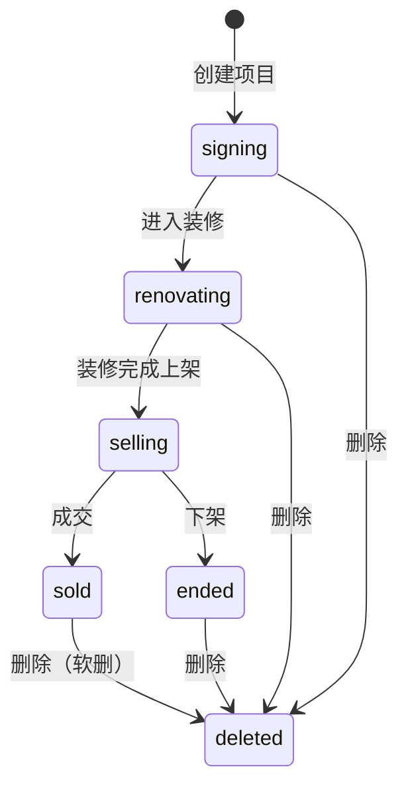

- 已售只能从在售/已售进入。
- 已下架只能从在售/已下架进入，且为终态（仅可转已删除）。
- 状态更新使用行级锁 + 最新状态二次校验，防并发 TOCTOU。
- 项目详情组件按阶段拆分（`_components/project-detail/views/`）：
  - `default/` — 基础信息 + 附件 + 交付 + 文书签收
  - `renovation/` — 装修时间线 + 合同 + 成本汇总 + 阶段照片
  - `selling/` — 活动 / 团队 / KPI / 成交对话框
  - `sold/` — 财务生命周期 + 视觉旅程 + 总结报告
  - `keys/` — 钥匙管理与审计

### 线索漏斗与评估

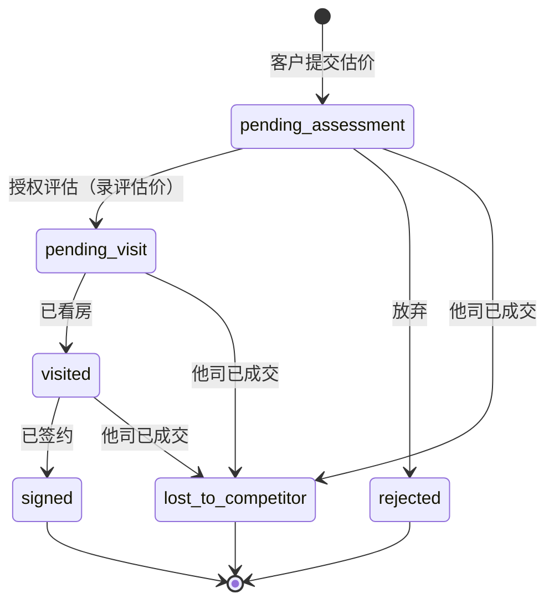

- 评估授权三动作：`approve`（写评估历史 + 流转待看房）、`reject`、`lost`。
- 再次评估：仅 `pending_visit` / `visited`，追加评估历史并覆盖 `eval_price`，不改状态与审核轨迹。
- 授权/审核统一写 `auditor_id` / `audit_time`；并发提交用行级锁 + 状态守卫返回 409。

### 楼盘字典导入与审核

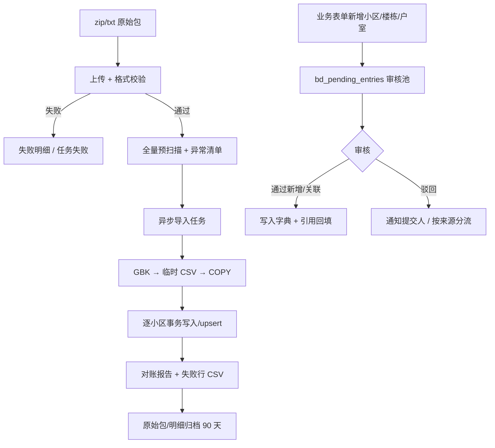

### 获客归因（4 链路）

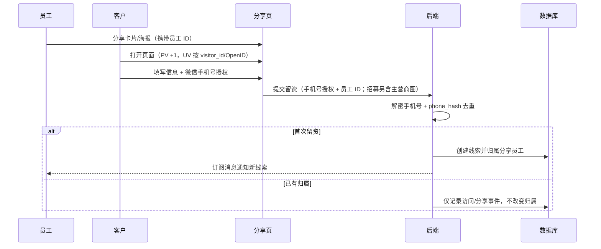

- **归属锚点**：首次成功留资；打开页面不建立归属。
- **多员工冲突**：按首次留资时间，后分享不覆盖。
- **UV 口径**：匿名链路按 `visitor_id` 跨表去重；招募按 `openid_hash` 按人去重；两者不可相加。
- **内部员工**：计入 PV，不计入 UV；留资按正常逻辑记录，业务侧人工筛选。
- **我的客户**：员工侧跨 4 模块聚合，状态机与后台统一。

### 钥匙管理与分享

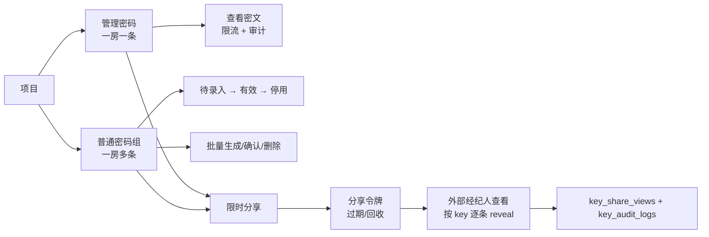

- 管理密码与普通密码均 Fernet 密文存储。
- 查看/生成/分享/停用全部写 `key_audit_logs`；外部查看另写 `key_share_views`。
- 分享有有效期，可续期/回收；外部页面只允许查看被分享的密码组。

### 房源上新/调价订阅

1. 用户在小程序房源列表/详情授权订阅（获得 1 次额度）。
2. admin 创建即发布（上新）或已发布房源调价（price_change）。
3. 后台任务分页拉取有额度订阅者，调用微信 `message/subscribe/send`。
4. 发送成功原子扣减额度；`43101`/`40003` 等未送达不扣额度，记录 `skipped`。
5. 结果写 `l4_marketing_notify_logs`；异常仅记日志，不影响主流程。

### 房源预约与统一线索状态

预约/估价/房源单/招募在获客中心统一为 **5 态状态机**：

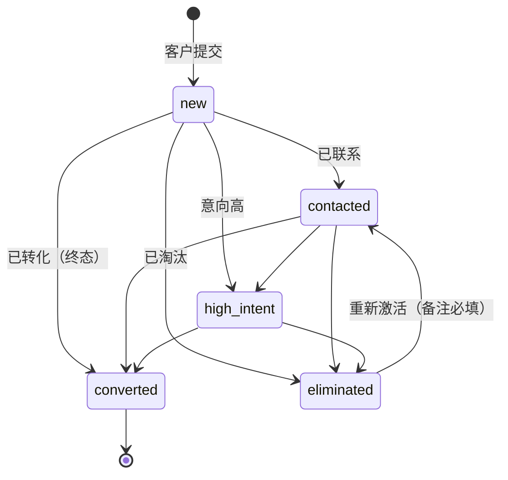

- `converted` 为终态（不可再流转，含自身）；`eliminated` 非终态，仅可重新激活到 `contacted`。
- 淘汰到 `eliminated` 时原因必填；重新激活时备注必填。
- 预约创建幂等：`(user_id, marketing_project_id)` 唯一，重复提交复用既有记录。
- 估价/房源单线在写统一状态的同时会按原因映射回写各业务线原生状态并记审计。

---

## 🌐 部署指南

### 部署架构

```
浏览器 / 微信小程序
        │
        ▼
宿主 Nginx (:80/443, HTTPS 终止)
        ├── /            → frontend 容器 127.0.0.1:3000（Next.js standalone）
        ├── /api/*       → backend  容器 127.0.0.1:8000（FastAPI）
        └── /static/*    → uploads volume / OSS
                                │
                                ├── db 容器（PostgreSQL 16）
                                └── redis 容器（Redis 7）
```

### 涉及文件

| 文件 | 作用 |
|------|------|
| [`docker-compose.yml`](docker-compose.yml) | 编排 db / redis / backend / frontend；仅暴露到 `127.0.0.1` |
| [`backend/Dockerfile`](backend/Dockerfile) | 多阶段构建（Python 3.13 + uv） |
| [`frontend/Dockerfile`](frontend/Dockerfile) | 三阶段构建（Node 22 + pnpm 11 → standalone） |
| [`.env.docker.example`](.env.docker.example) | 环境变量模板 |
| [`scripts/init-env.sh`](scripts/init-env.sh) | 生成 PostgreSQL/Redis/JWT/Fernet 密钥 |
| [`scripts/setup.sh`](scripts/setup.sh) | 初始化数据库与管理员（支持 `--docker`） |
| [`deploy-server.sh`](deploy-server.sh) | 服务器端部署：加载镜像、启动 compose、健康检查 |
| [`deploy-local.sh`](deploy-local.sh) | 本地构建并推送镜像到服务器 |
| [`docs/Base/deploy-lite.md`](docs/Base/deploy-lite.md) | 极简镜像构建/传输/部署教程 |

### 部署流程

```bash
# 1. 克隆代码
git clone <repo-url> profo && cd profo

# 2. 生成密钥并初始化 .env
./scripts/init-env.sh

# 3. 构建并启动
docker compose up -d --build

# 4. 初始化数据库 + 管理员（首次）
./scripts/setup.sh --docker

# 5. 验证
curl http://127.0.0.1:8000/health
docker compose ps
```

### 生产环境注意事项

1. **HTTPS**：compose 不含 nginx，需在宿主配置 nginx/Caddy/Traefik 并终止 HTTPS；反代目标 `127.0.0.1:3000` / `127.0.0.1:8000`。
2. **Proxy 头**：`proxy_set_header Host $host;`、`X-Forwarded-For`、`X-Forwarded-Proto`；配合 `TRUSTED_PROXIES`。
3. **密钥管理**：`.env` 严禁提交 Git；`ENCRYPTION_KEY` 生成后不可更改。
4. **数据库备份**：定期备份 `pgdata` 或 `pg_dump`：
   ```bash
   docker compose exec db pg_dump -U "$POSTGRES_USER" "$POSTGRES_DB" > backup_$(date +%F).sql
   ```
5. **资源限制**：1.6G 服务器已配置 `mem_limit`（db 384m / redis 32m / backend 512m / frontend 256m）。
6. **跨平台构建**：Mac arm64 必须构建 `linux/amd64`（compose 已默认）。
7. **日志轮转**：backend/frontend 已配置 json-file 50MB × 5；应用日志同时落盘 `backend/logs/app.log`。
8. **小程序**：不随 compose 部署；通过微信开发者工具上传/审核发布，需配置服务器域名白名单。

### 升级流程

```bash
git pull
docker compose up -d --build
# Schema 变更由 migrations/ 启动迁移自动执行
```

### 回滚/恢复

```bash
# 恢复数据库备份
gunzip -c backups/backup_YYYYMMDD_HHMMSS.sql.gz | \
  docker compose exec -T db psql -U "$POSTGRES_USER" "$POSTGRES_DB"

# 重建单服务
docker compose up -d --build backend
docker compose up -d --build frontend
```

---

## 🔄 数据迁移

### 启动时迁移（自动）

`backend/migrations/` 下迁移在应用启动时由 `main.py` 的 `lifespan` 调用 `run_startup_migrations(engine)` 自动执行，全部幂等：

- **多 worker 互斥**：PostgreSQL session-level advisory lock 串行化。
- **规模**：43 个迁移文件，77 个迁移函数。
- **执行顺序**：建表 → 加列/索引 → 类型修复 → 数据修复/回填 → 权限种子 → 业务数据迁移（含 OSS URL 改写 与楼盘字典修复）。
- **失败策略**：迁移异常向上抛出，阻止应用启动（fail loud）。

### 迁移分类（节选）

| 类别 | 代表迁移 | 说明 |
|------|---------|------|
| 加列/加索引 | `add_token_version_column`、`add_phone_hash_column`、`add_finance_record_counterparty_columns`、`add_key_audit_share_id_index`、`add_trgm_search_indexes` | 新列/索引（H-XXX 系列） |
| 建表 | `create_investment_tables`、`create_finance_subjects_table`、`create_recruit_tables`、`create_key_tables`、`create_property_sheet_tables`、`create_marketing_subscription_tables`、`run_building_dictionary_migrations` | 新业务表 |
| 权限系统 | `migrate_permission_system`、`add_role_is_system_column`、`add_permission_risk_level_column`、`add_permission_foreign_indexes` | 权限三表、内置角色保护、风险分级 |
| 加密/数据修复 | `encrypt_existing_phones`、`populate_phone_hash`、`run_fix_image_urls`、`backfill_bd_room_floor` | 明文加密、哈希回填、图片 URL、楼层回填 |
| 类型修复 | `migrate_all_datetime_columns_to_timestamptz`、`migrate_project_date_columns_to_date`、`migrate_encrypted_columns_to_text`、`widen_url_columns_to_text`、`migrate_uuid_columns_to_native_uuid` | 时区/日期/密文/URL/UUID 类型 |
| 枚举同步 | `add_cashflow_category_enum_values`、`migrate_add_ended_status` | PG enum 新增值 |
| 索引重建 | `rebuild_contract_no_index`、`cleanup_reserved_contracts`、`add_reports_indexes` | 合同号部分唯一、报表复合索引 |
| 业务数据 | `migrate_installation_stage_to_delivery`、`recover_stale_bd_import_tasks`、`run_bd_audit_20261017_fixes`、`run_bd_audit_20261018_fixes` | 阶段迁移、任务恢复、字典审查修复 |
| OSS | `migrate_uploads_to_oss` | 仅 `storage_backend=oss` 时改写 DB URL |
| 订阅 | `create_marketing_subscription_tables`、`add_published_at_to_l4_marketing_projects`、`widen_subscription_openid_columns` | 上新/调价订阅 |

> 新增 schema 变更必须：在 `migrations/` 下编写幂等迁移（`_column_exists` / `_index_exists` 检查），并在 `_run_all_migrations` 中按依赖顺序调用。

---

## 📐 开发规范

### 通用

- **不准猜**：需求歧义列出选项再问；困惑立刻停手描述。
- **全栈归位**：业务逻辑/持久化 → 后端；交互/计算/数据编排 → 前端。
- **最简代码**：不写非必需功能；单次使用不抽 util/hook；单文件 >500 行必须拆分或注释说明不拆理由。
- **精准修改**：只改需求相关，不动相邻代码/格式；清理孤儿 import/变量。

### 前端

- 默认 Server Component；仅需浏览器 API/客户端状态/纯客户端库时 `'use client'`。
- 消除请求瀑布：Server Component 中无依赖请求并行（`Promise.all` / `Suspense`）。
- shadcn/ui：不修改 `ui/` 源码；样式用 `cn()` 覆盖，逻辑封装到 `custom/`。
- 类型：API 消费必须用 `pnpm gen-api` 生成，禁手写。
- 表单 Zod schema 与后端 Pydantic 语义对齐。
- 国际化：`cLocale` 仅用于 C 端（`src/app/(c)/**`）；后台 admin 使用硬编码中文。
- `NEXT_REDIRECT` 守卫：Server Component 数据加载的 try/catch（含 `Promise.allSettled`）必须放行 `isRedirectError`，否则 401 自动刷新链断裂。

### 后端

- 严格分层 **Router → Service → Model**；Router 禁 SQLAlchemy 查询，禁止跨模型直接操作。
- 数据库操作使用同步 SQLAlchemy Session；I/O 密集型阻塞操作用 `run_in_executor` 放线程池。
- 关联用逻辑外键；数据库层不建 FK 约束，级联与关联完整性由 Service 处理。
- Service 层抛 `ServiceException` 子类，**禁止抛 `HTTPException`**。
- 所有函数完整类型注解；Pydantic 分 `*Create/*Update/*Response/*Filter`；动作类用 `*Request`。
- Schema 变更通过 `migrations/__init__.py` 幂等启动迁移；时间列 `DateTime(timezone=True)`，日期列 `Date`。
- 响应成功可裸返回模型；错误必须 `{"code": ≠0, "message": "..."}` + 标准 HTTP 状态码。

### 小程序

- 原生 TS，不引入大型运行时（如 zod）；表单校验原生实现。
- 请求统一走 `utils/request.ts`（超时、鉴权注入、SWR 缓存）。
- 新页面必须同步 `miniapp/types/api-types.d.ts`（`pnpm gen-api`）。
- 分包控制主包体积；内部功能放分包。

### 提交前检查

```bash
# 后端
cd backend
ruff check .
ruff format .
uv run pytest

# 前端
cd frontend
pnpm typecheck
pnpm lint
pnpm test
pnpm exec playwright test

# 小程序
cd miniapp
pnpm tsc
pnpm test
```

- 接口变更：启动后端 → `pnpm gen-api`（前端与小程序各自生成）→ 提交类型产物。
- 账号密码从环境变量读取，**严禁硬编码提交**。
- **修复必须附可复现验证**：优先 E2E 并产出可复验工件；无法自动化的留档命令、预期与实际输出。

### Conventional Commits

```
<type>(<scope>): <subject>

类型: feat | fix | docs | style | refactor | test | chore
```

---

## 🧪 测试与验证

| 层 | 工具 | 命令 | 说明 |
|----|------|------|------|
| 后端单测/集成 | pytest | `cd backend && uv run pytest` | PostgreSQL + SAVEPOINT 隔离，覆盖 service/router/权限/加密等 |
| 后端 E2E | 独立脚本 | `bash backend/tests/e2e/run_all.sh` | 楼盘字典 15 个 E2E 脚本，产出 `tests/e2e/artifacts/e2e-report-*.txt` |
| 前端单测 | Vitest | `cd frontend && pnpm test` | 组件/工具/表单校验 |
| 前端 E2E | Playwright | `cd frontend && pnpm exec playwright test` | 后台关键链路、附件、楼盘字典、营销调价 |
| 小程序单测 | Vitest | `cd miniapp && pnpm test` | 工具函数、页面逻辑、计算器 |
| 类型检查 | tsc | `pnpm typecheck` / `pnpm tsc` | 零错误 |
| Lint | ruff / ESLint | `ruff check .` / `pnpm lint` | `max-warnings 0` |

**E2E 约定**：

- 前端 E2E 凭据从 `frontend/.env.local` 的 `E2E_ADMIN_USER` / `E2E_ADMIN_PASSWORD` 读取。
- 后端 E2E 需后端运行在 `:8000`，使用 `.venv/bin/python` 执行。
- 开发期间不跑全套 E2E，结束前统一执行。

---

## ❓ 常见问题

### Q1: 后端启动报 `JWT_SECRET_KEY not set` / `ENCRYPTION_KEY not set`

```bash
./scripts/init-env.sh          # 自动生成 POSTGRES_PASSWORD / REDIS_PASSWORD / JWT_SECRET_KEY / ENCRYPTION_KEY
./scripts/init-env.sh --show   # 查看（默认打码）
./scripts/init-env.sh --force  # 强制重新生成
```

手动生成：

```bash
openssl rand -hex 32          # JWT_SECRET_KEY
python -c "from cryptography.fernet import Fernet; print(Fernet.generate_key().decode())"  # ENCRYPTION_KEY
```

### Q2: Docker 部署后后台登录显示「网络错误，请连接后端服务」

**根因**：frontend 容器内 Server Action 默认访问 `http://127.0.0.1:8000`，指向容器自身。

**修复**：`docker-compose.yml` 已配置 `SERVER_API_URL: http://backend:8000`。如仍报错：

```bash
docker compose exec frontend wget -qO- http://backend:8000/health
```

### Q3: 启动报 `POSTGRES_PASSWORD` URL 解析失败

**根因**：密码包含 `# @ : /` 等 URL 保留字符。

**修复**：使用纯字母数字密码，或 URL 编码：

```bash
python -c "import urllib.parse; print(urllib.parse.quote('你的密码'))"
```

### Q4: 忘记管理员密码

```bash
# Docker
./scripts/setup.sh --docker --reset-admin
# 本地
./scripts/setup.sh --reset-admin

# 指定新密码
./scripts/setup.sh --docker --admin-password 'YourNew!Pass1'
```

### Q5: 前端类型错误 `Property 'xxx' does not exist`

接口变更后未同步类型：

```bash
# 1. 启动后端
docker compose up -d backend
# 或本地：cd backend && uv run uvicorn main:app --reload --port 8000

# 2. 重新生成
cd frontend && pnpm gen-api
cd miniapp && pnpm gen-api
```

### Q6: API 返回 401 / 403

- 401：Token 缺失/过期/`token_version` 失效；检查 `Authorization` 或 Cookie。
- 403：CSRF 头缺失（纯 Cookie 写请求需 `X-Requested-With`）、权限不足、C 端/后台 Token 混用、业务身份校验失败。
- 检查用户 `status=active`、角色/权限点、`TRUSTED_PROXIES` 与 IP 限流。

### Q7: 文件上传失败

- 大小 ≤ 500 MB（`MAX_UPLOAD_SIZE`）。
- 扩展名白名单：`.jpg .jpeg .png .webp .pdf .xlsx .xls .csv .doc .docx .md .mp4 .mov .webm`。
- MIME 类型需匹配（`filetype` 嗅探）。
- `uploads` 挂载正常：`docker compose exec backend ls /app/static/uploads`。
- OSS 模式检查 5 个 `OSS_*` 配置。

### Q8: 前端启动报 `Module not found`

```bash
cd frontend
rm -rf node_modules .next
pnpm install
```

### Q9: 如何重置整个环境（清空数据）

```bash
# 推荐
./scripts/setup.sh --fresh-db
./scripts/setup.sh --docker --fresh-db

# 手动（危险）
docker compose down -v
docker compose up -d --build
./scripts/setup.sh --docker
```

### Q10: 启动报 `REDIS_URL not set` 或 Redis 连接失败

```bash
grep REDIS_PASSWORD .env
docker compose ps redis
docker compose logs redis
docker compose exec redis redis-cli -a "$REDIS_PASSWORD" ping   # PONG
```

> 空 `REDIS_PASSWORD` 会拒绝启动（防静默关闭认证）。Docker 下 `REDIS_URL` 由 compose 自动拼装，本地需手动设置。

### Q11: 切换到 OSS 后图片/视频 404

`STORAGE_BACKEND=oss` 时，启动迁移只改写 DB URL，**不会自动上传本地文件**：

```bash
cd backend
uv run python -m migrations.migrate_uploads_to_oss
docker compose restart backend
```

### Q12: 启动报 `password authentication failed for user "profo"`

**根因**：`pgdata` 卷用旧密码初始化，修改 `.env` 不会自动同步；Docker 卷是引擎级资源，不随项目目录删除。

```bash
# 保留数据（本地 / Docker 二选一）
./scripts/setup.sh --sync-db-password
./scripts/setup.sh --docker --sync-db-password
# 清空重建
./scripts/setup.sh --fresh-db
./scripts/setup.sh --docker --fresh-db
```

### Q13: 全新电脑首次初始化步骤

```bash
git clone <repo-url> profo && cd profo
./scripts/init-env.sh

# 本地开发
./scripts/setup.sh
./dev-start.sh

# Docker
docker compose up -d --build
./scripts/setup.sh --docker
```

### Q14: 小程序请求失败 / 无法登录

1. 微信公众平台「开发管理 → 服务器域名」是否配置 `https://fangmengchina.com`。
2. `miniapp/utils/config.ts` 的 `develop` 地址是否正确（本地联调）。
3. 后端 `WECHAT_APPID` / `WECHAT_SECRET` 是否与小程序一致。
4. 是否重新执行 `pnpm gen-api`（类型/接口路径漂移）。
5. 真机调试需 HTTPS 合法域名；开发者工具可勾选「不校验合法域名」。

### Q15: 订阅消息发送失败 / 用户收不到

- `43101`：用户拒收或额度已用完 → 不扣额度、记录 `skipped`。
- `40003`：OpenID 无效 → 检查用户绑定。
- 模板 ID 未配置 → 功能关闭（后台配置或环境变量）。
- 模板字段与代码不一致 → 检查 `WECHAT_*_TEMPLATE_ID` 对应模板。
- 小程序需先调用 `wx.requestSubscribeMessage` 获得额度。

### Q16: 楼盘字典导入很慢 / 内存占用高

- 单包 ≤ 2GB，全量预扫描 + 异步导入；大包建议分批。
- 导入使用 COPY + 逐小区事务；失败行可下载。
- 原始包与失败明细保留 90 天，启动/每日巡检自动清理。
- OrbStack 内存占用排查见 [`docs/2026-10-16-OrbStack内存占用10GB排查报告.md`](docs/2026-10-16-OrbStack内存占用10GB排查报告.md)。

---

## 📁 项目结构

```
ProFo/
├── README.md                      # 本文件
├── DESIGN.md                      # 设计风格参考（Steep 主题）
├── AGENTS.md                      # 编码规范
│
├── docker-compose.yml             # 生产编排（db / redis / backend / frontend）
├── docker-compose.dev.yml         # 开发 override（db / redis 端口映射）
├── .env.docker.example            # 环境变量模板
├── dev-start.sh                   # 本地开发一键启停（up/db/stop/status/logs/down）
├── dev-start.bat                  # Windows 版
├── deploy-local.sh                # 本地构建并推送镜像
├── deploy-server.sh               # 服务器加载镜像并启动
│
├── scripts/
│   ├── init-env.sh                # 生成密钥并初始化 .env（.bat/.ps1）
│   ├── setup.sh                   # 初始化数据库与管理员（.bat/.ps1）
│   └── restore-backup.sh          # 备份导入本地
│
├── frontend/                      # Next.js 16 前端
│   ├── src/
│   │   ├── app/
│   │   │   ├── (main)/admin/      # B 端后台
│   │   │   │   ├── building-dictionary/   # 楼盘字典（总览/导入/审核）
│   │   │   │   ├── communities/images/    # 旧图库入口（重定向字典）
│   │   │   │   ├── growth-center/         # 获客中心（总览/线索/漏斗/活动）
│   │   │   │   ├── investments/           # 跟投
│   │   │   │   ├── leads/                 # 线索（列表/新建/详情）
│   │   │   │   ├── ledger/                # 账本（项目/科目）
│   │   │   │   ├── marketing/             # 营销 CMS
│   │   │   │   ├── projects/              # 项目（详情/装修/销售/钥匙/待办）
│   │   │   │   ├── properties/            # 房源（列表/上传/治理重定向）
│   │   │   │   ├── recruit/               # 旧招募入口（重定向获客中心）
│   │   │   │   ├── reports/               # 报表（商圈/小区）
│   │   │   │   ├── settings/              # API Key / 订阅模板
│   │   │   │   ├── users/                 # 用户/角色
│   │   │   │   ├── audit-logs/            # 审计
│   │   │   │   └── page.tsx               # 工作台
│   │   │   ├── (c)/                       # C 端公开站
│   │   │   │   ├── projects/ valuation/ leads/ my/ profile/
│   │   │   │   ├── login/ register/ about/ contact/
│   │   │   │   └── page.tsx               # 首页
│   │   │   ├── admin/login/               # 后台登录
│   │   │   └── api/auth/                  # Token 刷新路由（admin / C）
│   │   ├── components/                    # ui（shadcn）/ c（C 端）/ custom / common
│   │   ├── lib/                           # api / auth / i18n / formatters / permissions
│   │   ├── hooks/
│   │   └── proxy.ts                       # Next.js 16 Proxy（鉴权/刷新/CSP）
│   ├── e2e/                       # Playwright E2E
│   ├── scripts/gen-api.mjs        # OpenAPI → TS 类型
│   ├── next.config.ts             # React Compiler / rewrites / bodySizeLimit
│   ├── playwright.config.ts
│   └── package.json
│
├── backend/                       # FastAPI 后端
│   ├── routers/                   # 15 个领域路由包
│   ├── services/                  # 业务编排（含 growth_center / property / property_sheet / recruit）
│   ├── models/                    # 73 张表（72 个映射模型 + 关联表）
│   ├── schemas/                   # Pydantic Schema
│   ├── dependencies/              # auth / common / projects / keys
│   ├── utils/                     # 加密/存储/限流/日志/文件安全
│   ├── constants/                 # 文书模板/角色码/待办规则
│   ├── migrations/                # 43 文件 / 77 幂等迁移
│   ├── tests/                     # pytest + e2e（15 个字典 E2E）
│   ├── main.py                    # 应用入口
│   ├── settings.py                # 配置（v0.9.0）
│   ├── db.py / error_handlers.py
│   ├── Dockerfile
│   └── pyproject.toml
│
├── miniapp/                       # 微信小程序「美房宝」
│   ├── app.json                   # 页面/分包/tabBar
│   ├── app.ts / app.wxss
│   ├── pages/                     # 主包 + 分包页面
│   ├── components/                # community-search / phone-bind-modal
│   ├── utils/                     # request / token / config / 计算器 / 分享
│   ├── types/api-types.d.ts       # 生成产物
│   ├── test-utils/                # Vitest 测试
│   ├── scripts/gen-env.mjs        # .env → utils/env.ts
│   └── project.config.json
│
├── docs/
│   ├── Base/                      # 业务说明 / API 文档 / 部署 / 培训手册
│   ├── design/                    # 高保真设计稿
│   ├── Done/                      # 需求/Spec/审查/排查报告
│   └── Weekly/
│
├── uploads/                       # 本地开发上传文件（bind mount）
├── backups/                       # 数据库备份
└── .github/workflows/lint.yml     # GitHub Actions Lint
```

---

## 📚 文档索引

### 核心业务与规范

- [业务说明（代理美化 / 收购美化）](docs/Base/business-specification.md)
- [房源数据结构报告](docs/Base/房源数据结构报告.md)
- [编码规范](AGENTS.md)
- [设计风格参考](DESIGN.md)
- [管理员培训手册](docs/Base/admin-training-manual/admin-training-manual.md)

### API 文档

- [通用约定](docs/Base/api/api-common.md)
- [项目](docs/Base/api/api-projects.md)
- [线索](docs/Base/api/api-leads.md)
- [市场](docs/Base/api/api-market.md)
- [营销](docs/Base/api/api-marketing.md)
- [监控](docs/Base/api/api-monitor.md)
- [系统](docs/Base/api/api-system.md)
- [C 端公开](docs/Base/api/api-public.md)
- [推送](docs/Base/api/push-api.md)

### 部署与运维

- [极简 Docker 构建部署](docs/Base/deploy-lite.md)
- [部署工作流](docs/Base/deploy-workflow.md)
- [OrbStack 内存占用排查](docs/2026-10-16-OrbStack内存占用10GB排查报告.md)

### 需求与迭代（节选）

- [楼盘字典需求规格（v1.9）](docs/Done/2026-10-12-楼盘字典-需求规格说明书.md)
- [楼盘字典性能与安全专项审查](docs/Done/2026-10-17-楼盘字典-性能与安全专项审查报告.md)
- [区域伙伴招募计划](docs/Done/区域伙伴招募计划.md)
- [获客中心迭代设计稿](docs/Done/2026-09-01-获客中心迭代-高保真设计稿.html)
- [小程序我的客户设计稿](docs/Done/2026-09-02-小程序我的客户-高保真设计稿.html)
- [项目待办看板需求](docs/Done/2026-09-30-项目待办看板-需求文档.md)
- [贷款计算器 Spec](docs/Done/2026-10-02-贷款计算器-spec.md)
- [购房模拟器](docs/Done/购房模拟器.md)
- [小程序架构设计](docs/Done/miniapp-architecture.md)

### 外部链接

- [FastAPI](https://fastapi.tiangolo.com/)
- [Next.js](https://nextjs.org/docs)
- [TailwindCSS](https://tailwindcss.com/docs)
- [SQLAlchemy](https://docs.sqlalchemy.org/)
- [PostgreSQL](https://www.postgresql.org/docs/)
- [Docker Compose](https://docs.docker.com/compose/)
- [shadcn/ui](https://ui.shadcn.com/)
- [uv](https://docs.astral.sh/uv/)
- [微信小程序开发文档](https://developers.weixin.qq.com/miniprogram/dev/framework/)

---

<p align="center">
  <b>ProFo — 让房地产翻新与销售管理更简单</b>
</p>
