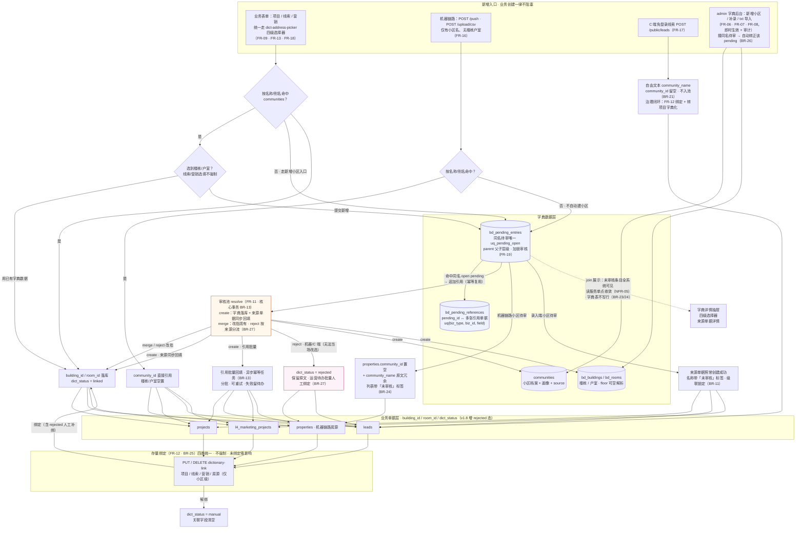

# 楼盘字典 · 需求规格说明书（SRS）

| 文档属性 | 内容 |
|---|---|
| 版本 | v1.9（2026-10-13） |
| 关联设计稿 | `docs/To-Do/2026-10-12-楼盘字典-高保真设计稿-v2.0.html`（交互原型 · Steep 视觉规范） |
| 历史版本 | v1.0 初稿 → v1.1 四级层级+审核池 → v1.2 BD-09+交互原型 → v1.3 九点口径收口 → v1.4 规格化梳理 → v1.5 全业务面覆盖缺口收口 → v1.6 未审核条目全系统可见 → v1.7 机器链路进审核池+线索/营销四级落库+三类统一绑定 → v1.8 流程评审收口（create 回填闭环+引用模型+并发唯一+reject 按来源分流+事务边界拆分+父子层级+properties 纳入绑定） → v1.9 governance 治理与小区图片管理以**交互融合**方式并入字典管理（抽屉合并按钮+搜索-勾选-合并弹层+合并信息区块/户型图库区块+解除合并，不设独立子页） |
| 适用读者 | 开发（后端/前端）、测试、产品协作方 |
| 文档地位 | 楼盘字典功能唯一权威需求依据；与设计稿冲突时以本文档为准并回报产品 |

---

## 1. 背景与目标

- **背景**：系统内房源地址长期为「小区名 + 手填门牌」软引用（`projects.community_name + address`），无结构化楼栋/户室数据，无法支撑按楼栋估价、同小区比价与钥匙定位。现已获得上海全域楼盘字典原始数据（37 批次 / 19,657 个 GBK txt，2017-06-20 ~ 2017-08-21 增量快照）。
- **数据画像**：唯一小区 19,655 / 楼栋 526,670 / 户室记录 7,332,314（约 97% 楼栋首户带 BD-09 坐标）；环线字段仅 内环内 5,778 / 外环外 7,557，其余 6,320 为空；跨批次重名小区 2 例。
- **产品目标**：
  1. 建成「小区 → 楼栋 → 楼层 → 户室」四级结构化字典（数据资产）；
  2. 全模块（线索/项目/营销等）新增时统一走字典选择器，存量数据手动关联（业务接线）；
  3. 字典支持持续生长：admin 直接补录 + 录入端提交经审核池入库（运营机制）。

## 2. 术语定义

| 术语 | 定义 |
|---|---|
| 小区（Community） | 字典第一级，复用现有 `communities` 表；name 全局唯一；「（别墅）/（公寓）」等后缀变体默认为独立小区 |
| 楼栋（Building） | 字典第二级 `bd_buildings`；楼栋号保留原始串（如 `01`、`100`、`201乙`、`惠园路2000弄01`），不做数字化抽取 |
| 楼层（Floor） | **呈现层字段，非独立实体**：由户室号前两位数字解析（`0401` → 4 层）；随该层首个户室创建而自动出现，无单独新增操作 |
| 户室（Room） | 字典第三级 `bd_rooms`；户室号保留原始串 |
| 未分层 | `floor = NULL` 的户室分组（非标户室号，如 `0233-1`、`1-2楼`），列表中置底展示 |
| 门牌自动拼装 | 由 `community_name + 楼栋号 + 室号映射` 生成门牌：`0401 → 401`、`0103 → 103`、`201乙` 栋 `0302 → 201乙302` |
| 补录（admin） | 字典后台的新增操作，可信、即时生效并写审计日志 |
| 提交（录入端） | 业务表单（新建项目等）中发起的新增，进入审核池，不直接写字典 |
| 转正 | 小区/楼栋/户室 pending 条目审核「通过新增」后写入字典，来源单据关联自动生效、「未审核」标签摘除 |
| 绑定 | 存量项目/线索/营销/房源（FR-12，v1.8 四类）通过 dictionary-link 端点建立与字典的结构化引用，数据层以字典为准；绑定不强制，未绑定单据零影响 |
| BD-09 | 百度坐标系。原始数据及一切新增坐标均为 BD-09，**原样落库、不转换、不改写** |
| governance | 小区治理（别名/档案合并）——**v1.9 起治理合并融合进字典交互**（抽屉「合并」按钮 + 搜索-勾选-合并弹层 + 合并信息区块/解除合并，无规则式「可合并」判定、无独立治理页；旧入口重定向至字典总览；merge 端点零改动，unmerge 为新增） |

## 3. 角色与权限

| 操作 | 权限 |
|---|---|
| 字典总览/详情/搜索（读） | 项目读权限（ProjectReadPermDep 同口径） |
| 画像修正 / 补录 / 新增小区 / 导入 | admin（CurrentAdminUserDep） |
| 审核池处理 | 默认 admin；经 `system_configs` 键 `building_dict_reviewer_roles`（缺省 `['admin']`）配置可处理角色 |
| 录入端提交（新增小区/楼栋/楼层/户室） | 具备对应业务模块新建权限的登录用户 |
| 存量绑定（项目/线索/营销/房源） | 对应单据可编辑者 |
| 治理合并（别名/档案合并） | `property:governance` 专用权限（现有口径，v1.9 合入后不变） |
| 小区图片管理（上传/排序/软删） | 沿用现有 `admin/communities/images` 权限口径（v1.9 合入后不变） |

## 4. 功能需求（FR）

### FR-01 字典总览页（`/admin/building-dictionary`）
- **描述**：KPI hero（小区/楼栋/户室/已关联项目数，Apricot 暖卡唯一）+ 筛选栏 + 小区表格 + 分页。
- **交互规格**：
  - 筛选维度：区域（区）/ 板块 / 环线 / 物业类型 / 建成年代 / 有无项目关联；关键词搜索匹配 **小区名 / 地址 / 别名**；
  - 表格列：小区（名 + 地址副行）、区域/板块、环线、物业类型、建成年代、楼栋数、户室数、已关联项目数（v2.0 修订：**删除总览首图缩略列**，首图仅在抽屉户型图库区块呈现）；
  - 分页 20 条/页；行点击打开详情抽屉（FR-02）；
  - 页头动作：`＋新增小区`（FR-07）、`审核池`（带待审核徽标计数）、`导入数据`（FR-08）。
- **边界**：环线为空显示「—」；搜索无匹配显示空态。

### FR-02 小区详情抽屉
- **描述**：总览行点击后右侧滑出 560px 抽屉。
- **交互规格**：上半部画像信息（地址、小区锚点坐标标注 BD-09、物业公司、开发商、楼栋/户室计数、已关联项目，v2.0 修订：画像区**不含首图缩略**）+ 抽屉头「**合并**」按钮（v1.9，FR-14）；`修正画像` 进入编辑态（环线/物业类型/建成年代，PATCH communities）；**户型图库区块（v1.9，FR-20）**：缩略图网格 + 上传/改描述/调排序/软删；**合并信息区块（v1.9，FR-14）**：已并入小区清单及其数据情况 + 单条「解除合并」；下半部楼栋列表（FR-03/04/05）与补录（FR-06）。

### FR-03 楼栋列表
- 楼栋号搜索；按自然序分页（20 栋/页）；非标楼栋号原样展示；
- 每行元信息：层数 × 每层户数、`admin 补录` 来源标记、坐标有无、已关联项目计数；
- 行点击展开 → 楼层分组（FR-04）；`＋添加楼栋`（FR-06，支持区间批量）。

### FR-04 楼层分组（呈现层）
- 分组规则：`floor = parseInt(户室号前两位)`；`floor = NULL` 归「未分层」组并**置底**；
- 可见楼层集合 = **名义层数 ∪ 实际户室楼层 ∪ pending 户室楼层**（审核新增的层自动出现；待审新楼层以「未审核」虚线样式出现，转正转正常、驳回移除）；
- 分组可折叠/展开；空层（架空层/设备层）不入字典，仅楼栋维度记录总层数展示。

### FR-05 户室网格
- 点击户室选中（单选高亮）；底部实时回显 `选中 X 栋 Y` 与户室坐标（BD-09）；
- 门牌自动映射仅用于展示与拼装（`0401 → 401`）；非标户室不参与（见 BR-02/BR-12）；
- **pending 户室**（进审核池未落库）：网格中带「未审核」标签、虚线/置灰样式（BR-23）；**仅来源单据回显选中**，其他业务表单中置灰不可选（hover 提示「审核中，通过后可选」）。

### FR-06 admin 补录（即时生效 + 审计）
- **新增楼栋**：楼栋号支持单值（`122乙`）或区间（`29-55`）；展开后逐个 uq 查重，跳过已存在，返回 `{added, skipped}`；
- **新增户室**：楼层支持单值/区间（`4`、`7-12`），户号尾号支持单值/区间（`03`、`01-08`）；笛卡尔展开；**新楼层号 = 隐式建层**；
- **批量上限**：单次 ≤ 60 栋 / ≤ 200 户，超限拦截；
- 全部写审计日志。

### FR-07 admin 新增小区
- 入口：字典总览页头 `＋新增小区`；
- 字段：小区名/区域/板块 **必填**；环线/锚点坐标（BD-09）/地址 可空；
- 校验：与现有小区重名 → 拦截并提示「直接选择；变体合并走 governance」；
- **与待审撞名（v1.8）**：写入前扫描同名 open pending → 自动转正该 pending（视同 admin 确认，留审计 + 通知提交人），不产生重复小区（BR-26）；
- 成功：写入 `communities` 即时生效，出现在总览与联想结果，留审计。

### FR-08 数据导入
- **流程**：上传（zip 整包或单 txt，单包 ≤ 2GB，GBK/UTF-8 自动识别）→ 解析校验（全量预扫描 + 异常清单）→ 异步导入执行 → 完成核对；
- **解析规则**：一个 txt = 一个小区，分号分隔，容错空行与单独「`;`」行；行1 为首个户室（楼盘名;楼栋;室号;经度;纬度）；属性段含物业类型/建成年代/物业公司/开发商/区域板块+地址/环线；
- **异常处理**：年代超合理区间 → 置空（约 1,204 行）；非标户室号 → 保留原串（约 3,877 行）；地址缺失 → 计入异常清单；首行无坐标小区 → 允许（536 个）；跨批次重名 → 按最新批次 upsert；
- **装载**：异步任务（复用 PropertyImportTask 模式），GBK → 临时 CSV → PostgreSQL COPY，逐小区事务；失败行写 csv 明细可下载；对账报告（小区/楼栋/户室计数）；原始包与明细归档 90 天；
- **任务历史**：任务 ID/触发人/时间/状态/进度/对账计数/失败明细。

### FR-09 四级地址选择器（共享组件 `dict-address-picker`）
- **级联**：小区联想（含别名，复用 `GET /admin/communities`）→ 楼栋 → 楼层 → 户室；
- **门牌自动拼装**：`community_name + 楼栋号 + 室号映射`，可手改；
- **兼容模式**：开关切换后跳过字典手填地址（小区可选），提交后 `dict_status = manual`；
- **复用范围**：新建项目、线索、营销等一切需要地址录入的新增表单（FR-13）。

### FR-10 录入端新增（进审核池，不阻塞业务创建）
- **新增小区**：搜索无结果时 `＋新增小区「{关键词}」…` 入口；表单同 FR-07；提交后：
  - pending 条目 `kind = community` 入池（来源单据泛化：项目/线索/营销，§8 bd_pending_entries.source_type）；
  - **业务单据（项目/线索/营销）照常创建成功**；
  - 单据名称显示**「未审核」标签**；级联（楼栋/楼层/户室）锁定并提示「小区审核通过后开放」；
  - 小区转正后标签自动摘除、级联解锁。
- **新增楼栋/楼层/户室**：录入端单值新增；「添加新楼层」= 提交该层首个户室；全部入审核池，不直接写字典；
- **pending 条目全系统可见（v1.6）**：待审楼栋/楼层/户室按 BR-23 以「未审核」标签叠加展示于字典详情抽屉（FR-02/03/04/05）、四级选择器（FR-09）与来源单据详情，字典表仍不写行；转正后并入正常展示并摘标签，驳回/合并后从展示层移除。

### FR-11 审核池（`/admin/building-dictionary/review`）
- **队列**：条目字段 提交时间/提交人/来源单据（v1.7 泛化：项目/线索/营销/房源）/小区/提交内容/状态；按提交时间排序；状态/小区筛选；KPI（待审核/已处理/累计合并/累计驳回）；
- **条目类型**：`kind = community | building | room`；
- **审核动作（三选一）**：
  - **通过新增（create）**：写入对应字典表（community→communities；building/room→bd_*），**并按引用记录回填（v1.8）**：创建来源单据同步回填转正（标签摘除），其余引用单据由事务提交后的异步幂等任务分批回填（BR-13）；
  - **合并现有（merge）**：不新增字典行，来源单据改指所选现有目标；小区档案合并提示到 governance 执行；
  - **驳回（reject）**：pending 关闭（终态 rejected），**按来源分流（v1.8，BR-27）**——录入端（在线表单）**必须当场为来源单据手动选择正确目标**（小区/楼栋/楼层/户室），单据立即改指；机器链路/C 端（异步来源）**无法当场改选** → 单据 `dict_status = rejected`（保留原文），转入运营待办支持批量人工绑定（经 FR-12 转正）；
- **约束**：merge/reject 未选目标（录入端）→ 提交拦截；已处理条目不可重复审核；**resolve 对 pending 行加锁，状态 `pending → 终态` 一次性成功，并发重复审核返回冲突（v1.8，FR-19）**；
- **事务**：**核心事务（v1.8，BR-13 修订）= pending 终态 + 字典落库（create）+ 创建来源单据回填**，单事务完成；引用单据批量回填走异步幂等任务；通知提交人可异步；
- 处理人权限见 §3。

### FR-12 存量数据绑定（项目 / 线索 / 营销 / 房源，v1.8 扩为四类统一）
- **范围**：存量项目（`/admin/projects/{id}/dictionary-link`）、存量线索（`/admin/leads/{id}/dictionary-link`）、存量营销房源（`/admin/marketing/projects/{id}/dictionary-link`）、**存量机器链路房源（`/admin/properties/{id}/dictionary-link`，v1.8 纳入——仅小区级绑定**：机器链路无楼栋/户室数据，结构由字典 txt 导入补齐；用于修正错配小区与 reject 后人工补绑）；
- 详情新增「字典关联」卡：展示 community_name / 手填门牌或楼层文本 / 楼栋关联 / 户室关联 / 状态 chip；
- 动作：`关联字典` / `修正关联` / `解除关联`（PUT / DELETE）；
- **绑定确认后数据层以字典数据为准**（community_id / building_id / room_id / dict_status 生效）；项目**原手填 address 原值保留转为备注**，线索/营销/房源原 community_name 保留为冗余展示不改写；
- 存量列表支持按「未关联」筛选；小区名精确匹配的自动预填小区；
- keys 模块随项目关联自动获得结构化定位，无独立改造。

### FR-13 全模块统一入口（新建 + 编辑）
- 线索/项目/营销等所有涉及地址录入的**新建表单**，地址区统一替换为 FR-09 共享选择器；
- **项目编辑**（`PUT /projects/{id}`）：修改小区/地址同样走 FR-09 选择器（可切换兼容模式手填保底，`dict_status` 随之流转，见 §6.2）；不再支持纯自由文本改写小区名；
- **落库口径（v1.7）**：项目维持选择器细化到户室 + 兼容模式保底；**线索/营销小区必选、楼栋/户室选填**（选到则 `building_id/room_id` 落库，未选则空置，不阻塞单据创建；线索/营销表补列见 §8）；
- 提交载荷：`building_id + room_id`（已有字典数据）或 `new_community / new_building / new_room` 载荷（进审核池，业务单据照常创建）。

### FR-14 治理合并融合进字典交互（v1.9 定稿：无规则式「可合并」判定，合并从抽屉发起）
- **合并入口**：小区详情抽屉「合并」按钮（唯一入口，权限 `property:governance`）——**不做规则式「可合并」标记/归簇推荐**（与现有前后端能力无关、需额外逻辑且效果不可衡量，v1.9 修订拍板）；
- **合并弹层 = 搜索-勾选-合并**：全库按小区名/地址检索（覆盖名字差异巨大的同一小区，如「金杨七街坊」vs「枣庄路810弄」）→ 勾选目标主档 → **合并影响预览**（别名吸纳 / 关联单据改指 / 图片归属 / 楼栋户室归并计数）→ 确认调用现有 `POST /admin/communities/merge`（**零改动**，写审计；被并小区软归档保留）；
- **合并信息区块**：抽屉内呈现已并入本小区的小区及其数据情况（名称/地址/楼栋/户室/已绑计数）——数据来源 = `communities.merged_into_id`（归档并入时写入，见 §8）；
- **解除合并（字典模块新增能力）**：区块内单条「解除合并」→ `POST /admin/communities/unmerge`——恢复归档小区（is_active 置回）、清 `merged_into_id`、移除并入时吸纳的别名，单事务 + 审计；被并小区数据因软归档保留，可**无损拆回**；
- **不设独立治理页面**：旧入口 `/admin/properties/governance` 重定向至字典总览；仍不做相似度推荐（v1.3 拍板维持）。

### FR-20 小区图片管理融合进字典交互（v1.9 定稿：不设独立图片页）
- **图片操作全部内嵌字典**：详情抽屉「户型图库」区块（缩略图网格 + 上传 / 改描述 / 调排序 / 软删）为**唯一管理界面**；
- ~~字典总览表格增加首图缩略列~~（**v2.0 修订：删除总览首图缩略列**，与高保真设计稿 v2.0 画面对齐；图片入口仅抽屉户型图库区块）；
- **复用现有端点零改动**（`GET/POST /admin/communities/{community_id}/images`、`PATCH/DELETE /admin/community-images/{image_id}`）；
- **不设独立图片管理页**：旧入口 `/admin/communities/images` 重定向至字典总览；
- 权限沿用现有图片管理口径；合并小区时图片随主档收敛（merge 现有逻辑）。

### FR-15 权限与配置
- 见 §3 权限矩阵；审核处理人配置键 `building_dict_reviewer_roles`（复用待办看板规则配置的单键读写模式，缺省 `['admin']`）。

### FR-16 房源链路口径（外部推送 / CSV 房源导入，v1.7 改为进审核池）
- **范围**：`POST /push`（X-API-Key 外部推送）与 `POST /upload/csv`（房源批量导入）现有链路——该链路仅有小区名，**无楼栋/户室结构数据**；
- **小区一致**：按名称/别名命中字典 → 直接引用（community_id 落库），楼栋/户室空置（机器链路无结构数据）；
- **小区不一致**：**不自动建小区，产生 pending 条目（kind = community）进审核池**，推送/导入**照常成功不拦截**；房源记录小区名存原文（`properties` 补 `community_name` 冗余列）、community_id 置空（由 NOT NULL 放宽为可空，见 §8），列表展示带「未审核」标签（BR-23 join 口径）；
- **审核通过（create）**：communities 落库 + 来源房源 community_id 回填转正（标签摘除）；merge/reject 口径同 FR-11（必须当场改指现有小区）；
- **楼栋/户室补齐**：由 FR-08 字典 txt 导入或人工绑定（FR-12）承担，互不阻塞；
- **重名/变体**：沿 BR-01 拦截口径 + FR-14 governance 治理。

### FR-17 C 端免登录线索口径（v1.5）
- **范围**：小程序估价/卖房线索（`POST /public/leads`，免登录）；
- **口径**：**维持自由文本**——搜不到小区时仍以关键词当 `community_name` 提交（`community_id` 留空），C 端零改动、不进审核池、不校验字典；
- **字典化时机**：线索转项目（员工/运营操作）时走 FR-09 选择器，或后台经 FR-12 绑定；若为新小区则自然进 FR-10 审核池；
- **治理闭环（v1.8 补充说明）**：C 端不入池 ≠ 治理盲区——C 端线索归属 leads 表，纳入 FR-12 绑定与「未关联」筛选，后台可批量人工补绑；线索转项目时必经选择器字典化。口径维持 v1.5 拍板：C 端零改动、不产生 pending。

### FR-18 线索端字典对接（v1.7 扩展：楼栋/户室选填不强制）
- **员工录线索**（`POST /leads`）与线索页「修改小区」：地址区接 FR-09 四级选择器——小区必选（联想复用 `GET /admin/communities`，含别名），**楼栋/楼层/户室选填**（选到则 `building_id/room_id` 落库，未选则空置，不阻塞线索创建）；
- **搜不到小区时**：登录员工可提交「新增小区」→ 进 FR-10 审核池（kind = community），线索照常创建并带「未审核」标签；楼栋/户室新增同样进审核池（kind = building/room）；
- 线索表补列 `building_id/room_id/dict_status` 见 §8；存量线索绑定见 FR-12；
- **C 端免登录线索不在此列**（FR-17 维持自由文本）。

### FR-19 pending 引用与并发唯一（v1.8 新增，评审收口）
- **引用记录**：新增 `bd_pending_references(pending_id, biz_type, biz_id, field)`——同一 pending 条目可被多张单据引用；首位提交者记为「创建来源」（`source_type/source_id` 冗余保留），后续单据提交时**命中同名 open pending 即追加引用而非新建条目**（幂等复用）；
- **同名唯一**：pending 表加 partial unique `uq_pending_open(kind, parent_id, normalized_name) WHERE status='pending'`——同名待审条目全局唯一，杜绝并发重复提交（community 的 parent_id 为空；normalized_name = 去空白/全半角归一后的名称）；
- **父子层级**：pending 补 `parent_kind + parent_id`（指向字典实表 id 或父级 pending 条目 id）——楼栋/户室 pending 必须挂父级（父级也是待审时挂 pending 条目）；审核按拓扑序：**父级未转正，子级不可单独转正**（可同批审核一次性落库）；merge 父级时子级引用级联改指（BR-28）；
- **resolve 并发控制**：审核时对 pending 行加行锁（`SELECT ... FOR UPDATE`）或乐观锁，状态必须 `pending → 终态` 一次性成功，并发重复 resolve 返回冲突错误（409）；
- **create 回填**：审核通过后按引用记录回填引用单据的关联字段并摘「未审核」标签——创建来源同步（核心事务内），其余引用由异步幂等任务分批回填（BR-13）。

## 5. 业务规则与边界条件（BR）

| 编号 | 规则 |
|---|---|
| BR-01 | 同名小区：导入按 name upsert 幂等；录入端/admin 新增重名 → 拦截并提示直接选择或走 governance |
| BR-02 | 非标户室号（`0233-1`、`1-2楼` 等）：保留原串、`floor=NULL` 归未分层、**不参与门牌自动拼装** |
| BR-03 | 非标楼栋号（`201乙`、`惠园路2000弄01` 等）：保留原始串，不做数字化抽取 |
| BR-04 | 环线缺失（约 6,320 个小区）：允许为空，展示「—」，支持人工补齐 |
| BR-05 | 年代脏值（如 1800、2301）：导入时置空 |
| BR-06 | 无锚点小区（首行无坐标，536 个）：允许，坐标相关展示留空 |
| BR-07 | 区间展开上限：楼栋 ≤ 60/次、户室 ≤ 200/次，超限拦截并提示 |
| BR-08 | 区间全部已存在：不产生新增，返回 `{added:0, skipped:N}` 并提示 |
| BR-09 | 唯一约束冲突：uq(community_id, building_no)、uq(building_id, room_no) → 批量场景跳过、单场景拦截 |
| BR-10 | merge/reject 必须显式选择目标（默认不预选「必选」占位），未选提交拦截 |
| BR-11 | 小区审核中：级联锁定 + 项目可提交（名称带「未审核」标签） |
| BR-12 | 非标户室被选中：门牌回退手填提示 |
| BR-13 | **审核落地事务边界（v1.8 修订）**：核心事务 = pending 终态 + 字典落库（create）+ 创建来源单据回填，单事务完成、禁止半提交；引用单据批量回填走事务提交后的**异步幂等任务**（分批、可重试、失败留待办），避免跨大批量业务行的大事务（同库单体，不引入 outbox/saga） |
| BR-14 | 楼层已存在时再次「添加新楼层」 → 拦截并引导直接选择该层 |
| BR-15 | 空层（架空层/设备层）不入字典 |
| BR-16 | 导入任务重跑幂等（按 uq 键 upsert），计数不变 |
| BR-17 | 已处理 pending 条目不可重复审核（前端置灰 + 后端校验） |
| BR-18 | 坐标一律 BD-09 原样落库；展示层标注「BD-09」；跨服务商转换收敛在 `services/geo.py` 单点 |
| BR-19 | 关联字典不改动存量 `address` 原值；手填门牌与字典户室并存时以 `room_id` 为准 |
| BR-20 | 房源链路（`/push`、`/upload/csv`）小区不一致**不自动建小区**，产生 pending 条目进审核池（kind=community），推送/导入照常成功不拦截；小区一致直接引用，楼栋/户室空置；审核转正前房源列表带「未审核」标签（FR-16） |
| BR-21 | C 端免登录线索维持自由文本小区名，不做字典校验、不产生 pending 条目；字典化延迟到线索转项目时（FR-17） |
| BR-22 | 项目编辑改小区/地址与新建同口径走选择器（兼容模式保底），禁止绕过字典纯自由文本改写（FR-13） |
| BR-23 | pending 楼栋/楼层/户室**全系统可见带标签**：展示层叠加 `bd_pending_entries(status=pending)` 数据（虚线/置灰 + 「未审核」标签），字典表不写行；pending 户室仅来源单据回显选中，其他业务表单置灰不可选；转正摘标签转正常，驳回/合并即从展示移除（FR-10）；数据实时性以查询时 join 为准，不做缓存 |
| BR-24 | 线索/营销/机器链路房源的 pending 展示与约束同 BR-23：pending 小区/楼栋/户室带「未审核」标签全系统可见，pending 楼栋/户室仅来源单据回显选中、其他表单置灰不可选；转正摘标签，驳回/合并按 BR-10 改指（FR-16/FR-18） |
| BR-25 | 存量绑定与项目同口径（FR-12，v1.8 扩为四类含 properties）：绑定后 community_id/building_id/room_id/dict_status 生效，原 community_name 冗余字段保留不改写；绑定不强制，未绑定单据零影响 |
| BR-26 | **同名并发唯一（v1.8）**：pending 按 `uq_pending_open`（FR-19）全局唯一，后续同名提交幂等复用并追加引用；resolve 加锁防并发重复审核；admin 新增小区/补录/txt 导入写入前扫描同名 open pending → 自动转正（视同 admin 确认，留审计 + 通知提交人），不产生重复小区 |
| BR-27 | **reject 按来源分流（v1.8）**：录入端（在线表单）reject 当场改选 → 单据立即改指 linked；机器链路/C 端（异步来源）reject → 单据 `dict_status=rejected`、保留 community_name 原文、生成运营待办，经 FR-12 批量人工绑定后转 linked |
| BR-28 | **pending 父子层级（v1.8）**：楼栋/户室 pending 必须挂父级（字典实表或父级 pending）；审核按拓扑序——父级未转正子级不可单独转正；merge 父级时子级引用级联改指；展示层父级待审时子级随父级带「未审核」标签 |

## 6. 状态机

### 6.1 审核条目（bd_pending_entries.status）
```
pending ──通过新增(create)──▶ created   （写入字典 + 来源单据同步回填 + 引用异步回填）
pending ──合并现有(merge)──▶ merged     （改指现有目标，字典无新增）
pending ──驳回(reject)─────▶ rejected   （录入端当场改选改指；机器/C 端标记 rejected 转运营待办）
终态不可逆；merge/reject 必须携带目标 id（录入端，BR-10/27）
并发控制（v1.8）：resolve 对 pending 行加锁，状态 pending → 终态一次性成功，重复审核返回 409（FR-19）
```

### 6.2 业务单据字典关联（dict_status：projects / leads / l4_marketing_projects / properties，v1.8 增 rejected 态）
```
manual（手填/未关联）──关联/审核转正──▶ linked
manual/linked ──录入端提交新增──▶ pending（审核中，名称带「未审核」标签）
pending ──created/merge/reject(当场改选)──▶ linked（标签摘除）
pending ──reject(机器链路/C 端，无法当场改选)──▶ rejected（保留原文，转运营待办，BR-27）
rejected ──人工绑定（FR-12）──▶ linked
linked ──解除关联──▶ manual
```
前端「未审核」等标签一律由 `dict_status` + pending join 计算得出，禁止按名称字符串判断（v1.8）。

### 6.3 导入任务
```
解析校验 ──开始导入──▶ 执行中（进度/对账计数实时）──▶ 已完成 ｜ 部分失败（失败明细 csv）
```

### 6.4 架构与数据流总览（v1.7 新增 / v1.8 随评审重绘）

各新增渠道（表单选择器 / 机器链路 / C 端 / admin 后台）的分流逻辑、pending 引用与审核回填闭环、reject 分流与四类存量绑定的全景数据流：



图例要点：① 三渠道新增均先按名称/别名匹配 `communities`，命中即引用、未命中进 `bd_pending_entries`（唯一例外：C 端免登录维持自由文本不入池，治理走 FR-12 绑定）；② 同名提交经 `uq_pending_open` 幂等复用同一条 pending 并追加引用记录，审核 create 后**创建来源同步回填、其余引用异步幂等分批回填**（BR-13 修订的事务边界）；③ reject 按来源分流：录入端当场改指，机器/C 端落 `rejected` 转运营待办、经 FR-12 人工补绑转正（BR-27）；④ admin/导入写入前撞同名 open pending → 自动转正，杜绝重复小区（BR-26）；⑤ 楼栋/户室 pending 挂父级、拓扑审核（BR-28）；⑥ 所有 pending 叠加展示统一走字典读服务单点，禁止业务代码自行 union（NFR-05）。

## 7. 非功能需求（NFR）

| 编号 | 类别 | 要求 |
|---|---|---|
| NFR-01 | 性能 | 733 万户室行走异步任务 + PostgreSQL COPY 批量装载，逐小区事务，可关闭页面；`bd_rooms` uq(building_id, room_no) 覆盖详情查询；小区列表走 communities（1.97 万行）；楼栋列表按 community_id 索引；户室分页 20/页 |
| NFR-02 | 数据完整性 | 导入重跑幂等；对账报告（小区/楼栋/户室三计数）；异常行 csv 留档 90 天 |
| NFR-03 | 安全与审计 | 写操作（补录/新增小区/导入/审核）限 admin + 审计日志；审核处理人配置化；账号口令从环境变量读取 |
| NFR-04 | 兼容性 | GBK/UTF-8 自动识别；分号分隔容错（空行、单独「;」行、`errors="replace"`） |
| NFR-05 | 可维护性 | 坐标转换单点 `services/geo.py`；选择器共享组件 `dict-address-picker`；**pending 叠加读路径统一收敛在字典读服务单点（v1.8），禁止业务代码各自 union 正式表与 pending 表**；迁移经 `migrations/__init__.py` 幂等脚本（_table_exists/_column_exists）；类型经 `pnpm gen-api` 生成 |
| NFR-06 | 可用性 | 视觉遵循 DESIGN.md（Steep）；桌面 1440 优先；操作即时反馈（toast/状态标签/徽标）；详情抽屉 560px |
| NFR-07 | 数据口径 | 2017 快照定位为「基础字典 + 运营修正」；BD-09 原样落库 |

## 8. 数据规格

| 表/实体 | 规格 |
|---|---|
| `communities`（扩展） | + `lng/lat`（BD-09 小区锚点）、`ring`（环线）、`property_types text[]`、`era_from/era_to`、`developer`、`property_mgmt`、`address`、`source`（值域：`admin` 后台补录 / `review` 审核转正——v1.7 起录入端与机器链路新增小区统一经审核转正，原 `import` 自动建值域废止）、**`merged_into_id`（可空，v1.9：被并入主档时写入，合并信息区块与解除合并依据）**；已有 name 唯一/district/business_circle/别名机制保留 |
| `bd_buildings`（新增） | id bigserial；community_id 逻辑外键；building_no 原始串；lng/lat（首户坐标）；room_count 冗余计数；**uq(community_id, building_no)** |
| `bd_rooms`（新增） | id bigserial；building_id 逻辑外键；room_no 原始串；`floor` 可空解析字段（0401→4，非标 NULL）；**uq(building_id, room_no)**；约 733 万行 |
| `bd_pending_entries`（新增） | kind（community/building/room）；community_id；提交内容（楼栋/楼层/户室 或 小区表单快照）；submitted_by；**source_type + source_id（创建来源冗余，v1.7 泛化：project/lead/marketing/property）**；**normalized_name + parent_kind + parent_id（v1.8，FR-19）**；status（§6.1）；resolved 目标 id（merge/reject）；resolved_by/at；**partial unique `uq_pending_open(kind, parent_id, normalized_name) WHERE status='pending'`** |
| `bd_pending_references`（新增，v1.8） | pending_id（逻辑外键）；biz_type（project/lead/marketing/property）；biz_id；field（community_id/building_id/room_id）；status（open/resolved）；**uq(biz_type, biz_id, field)**——同一 pending 的多单据引用账本，create/merge/reject 按此批量回填/改指 |
| `projects`（扩展） | + `building_id`（可空）、`room_id`（可空）、`dict_status`（linked/manual/pending/rejected，§6.2）；保留 community_id/community_name/address；新建表单可携带 `new_community/new_building/new_room` 载荷 |
| `leads`（扩展，v1.7） | + `building_id`（可空）、`room_id`（可空）、`dict_status`（linked/manual/pending/rejected）；已有 community_name（必填）/community_id（可空软引用）保留 |
| `l4_marketing_projects`（扩展，v1.7） | + `building_id`（可空）、`room_id`（可空）、`dict_status`（linked/manual/pending/rejected）；已有 community_id（必填）/community_name（冗余）保留 |
| `properties`（扩展，v1.7） | `community_id` 由 NOT NULL **放宽为可空**（机器链路 pending 期间置空）；+ `community_name`（可空冗余列，机器链路存小区名原文，转正后仍以 community_id 为准） |
| 迁移 | `migrations/__init__.py` 追加幂等脚本；建表（含 bd_pending_references）+ communities/projects/leads/l4_marketing_projects/properties 补列（含 communities.merged_into_id）+ `uq_pending_open` partial unique；PostgreSQL 兼容 |

## 9. 端点规格（摘要）

| 端点 | 方法 | 说明 |
|---|---|---|
| `/admin/building-dictionary/import` | POST | 上传 zip/txt → 异步任务（PropertyImportTask 模式 + 失败明细） |
| `/admin/building-dictionary/import/tasks` | GET | 任务历史（状态/进度/对账/失败明细 URL） |
| `/admin/building-dictionary/communities` | GET / POST | GET 总览（筛选/分页/计数）；POST admin 新增小区（FR-07） |
| `/admin/building-dictionary/communities/{id}` | GET / PATCH | 详情（楼栋分页/画像）；修正画像；别名合并不在本端点（→ governance） |
| `/admin/building-dictionary/buildings` · `/buildings/{id}/rooms` | POST | admin 补录（含区间语法批量，返回 `{added, skipped}`） |
| `/admin/building-dictionary/review` | GET | 审核池列表 + KPI（按提交时间排序） |
| `/admin/building-dictionary/review/{id}/resolve` | POST | `action=merge|create|reject`，pending 行加锁（并发重复审核 409，FR-19）；核心事务 = 终态 + 字典落库（create）+ 来源单据同步回填，引用批量回填走异步幂等任务（BR-13）；reject 按来源分流（BR-27） |
| `/admin/projects/{id}/dictionary-link` | PUT / DELETE | 存量项目绑定/修正/解除（数据层以字典为准） |
| `/admin/leads/{id}/dictionary-link` | PUT / DELETE | 存量线索绑定/修正/解除（v1.7，FR-12） |
| `/admin/marketing/projects/{id}/dictionary-link` | PUT / DELETE | 存量营销房源绑定/修正/解除（v1.7，FR-12） |
| `/admin/properties/{id}/dictionary-link` | PUT / DELETE | 存量机器链路房源绑定/修正/解除（v1.8 纳入，仅小区级，FR-12/BR-25） |
| `/admin/building-dictionary/review/pending-backfill` | POST | 引用批量回填任务重试入口（v1.8，异步幂等任务失败后的运营重跑，BR-13） |
| `/admin/building-dictionary/governance` | ~~页面~~ | **v1.9 修订（FR-14）**：~~治理台路由迁移~~ → **不设独立治理页**：合并从抽屉「合并」按钮发起（搜索-勾选-合并弹层），复用 `POST /admin/communities/merge`（零改动）；旧入口 `/admin/properties/governance` **重定向至字典总览** |
| `/admin/building-dictionary/images` | ~~页面~~ | **v1.9 修订（FR-20）**：~~图片页路由迁移~~ → **不设独立图片页**：图片操作内嵌抽屉「户型图库」区块（v2.0：总览首图列已删），复用 `GET/POST /admin/communities/{id}/images`、`PATCH/DELETE /admin/community-images/{id}`（零改动）；旧入口 `/admin/communities/images` **重定向至字典总览** |
| `/admin/communities/unmerge` | POST | **v1.9 新增（FR-14）**：解除合并——恢复归档小区（is_active）、清 `merged_into_id`、移除并入时吸纳的别名，单事务 + 审计；`merge-communities` 端点本身零改动 |
| 各模块新增表单 | — | 地址区统一选择器；载荷 building_id/room_id 或 new_* 载荷 |
| `PUT /projects/{id}` | PUT | 编辑改小区/地址同新建口径走选择器（FR-13/BR-22）；兼容模式提交 dict_status=manual |
| `POST /leads` · `PUT /leads/{id}` | POST / PUT | 地址区接四级选择器（FR-18）：小区必选、楼栋/户室选填；无匹配可提交新小区/楼栋/户室进审核池 |
| `POST /push` · `POST /upload/csv` | POST | 房源链路口径调整（FR-16）：小区一致直接引用；不一致产生 pending 条目进审核池、推送/导入照常成功，**不再自动建小区** |
| `POST /public/leads` | POST | C 端免登录线索**不变更**：自由文本小区名照旧（FR-17） |
| `GET /admin/communities` | GET | 小区联想（含别名合并）复用现有端点 |

## 10. 验收标准（AC）

### AC-P0（导入 + 字典浏览，对应原型页 01/02）
1. 上传样本包 → 解析报告计数与预扫描一致；
2. 导入完成 → 对账：小区/楼栋/户室三计数全一致；
3. 重跑同包 → 计数不变（BR-16）；
4. 脏数据 → 异常行落 failed csv 且不入库；
5. 总览筛选（区/环线/类型）+ 搜索 + 详情抽屉楼栋→楼层→户室展开正确；
6. 批量补录「29-55」号楼、「7-12」层×「01-08」室 → 展开计数正确、uq 跳过、超上限拦截；
7. admin 新增小区 → 即时生效并出现在总览与联想。

### AC-P1（选择器 + 审核池 + 存量关联，对应原型页 03/04/05）
1. 新建项目：搜「宝山三村」→ 61 栋 4 层 0401 → 预览「61号401」→ 提交后 building_id/room_id/dict_status=linked 落库；
2. 录入端新增小区 → kind=community 入池、项目创建成功且名称带「未审核」标签；「通过新增」→ communities 落库 + 项目转正摘标签 + 通知；
3. 录入端添加新户室 0403 → pending 落库、字典无新数据；「通过新增」→ bd_rooms 新增 + 项目关联；
4. 「合并现有」→ 不新增字典行、项目指向所选目标；
5. 「驳回」→ 未选目标拦截；改选后提交 → 项目立即关联、pending=rejected；
6. 审核池处理人权限：非配置角色不可见/不可处理；
7. 存量项目「关联字典」→ building_id/room_id 落库且 address 不变；钥匙、待办看板回归无影响；
8. 兼容模式 → 手填提交成功（dict_status=manual）；
9. 非标户室 → 门牌回退手填提示、「未分层」组置底；
10. 新增楼层（7 层 0701）→ 审核通过后该层自动出现在楼层列表（名义层数 ∪ 实际户室楼层）。

### AC-P2（全业务面边界场景，v1.5 定版 / v1.7 修订）
1. 外部推送 `POST /push` 携带字典中不存在的小区名 → **推送照常成功、communities 不自动建行**，产生 kind=community pending 条目；房源记录 community_id 置空、列表带「未审核」标签；审核「通过新增」→ communities 落库 + 房源 community_id 回填转正摘标签；
2. 外部推送/CSV 导入携带字典已有小区 → community_id 直接引用，楼栋/户室空置，无 pending 条目；
3. C 端免登录估价线索搜不到小区 → 关键词自由文本提交成功，无 pending 条目；
4. 编辑项目改小区 → 强制选择器（兼容模式可手填，dict_status 流转见 §6.2）；纯自由文本改小区名被拦截；
5. 员工录线索搜不到小区 → 提交新小区进审核池，线索照常创建；「通过新增」后线索 community_id 关联生效、标签摘除；
6. 营销模块（community_id 必填）经字典联想选择无回归；L3 导入反查行为不变。

### AC-P3（未审核条目展示，v1.6）
1. 录入端提交新户室 0403 → 来源项目详情与选择器级联立即回显该户室（「未审核」标签 + 虚线/置灰）；
2. 其他用户打开同楼栋楼层分组 / 选择器 → 同样可见 pending 户室（带标签），但置灰不可选（hover 提示「审核中，通过后可选」）；
3. 待审新楼层（首户 0701 待审）→ 楼层组带「未审核」样式出现于楼层列表（FR-04 可见楼层集合并集）；
4. 审核通过（create）→ 字典落库、标签摘除，所有用户正常可选；
5. 驳回/合并 → pending 条目从所有展示层消失，来源项目按 BR-10 改指目标；
6. 字典表计数不受 pending 展示影响（对账三计数以 bd_* 实表为准）。

### AC-P4（线索/营销四级落库 + 三类绑定 + 机器链路进池，v1.7）
1. 员工录线索选到户室 → `leads.building_id/room_id` 落库、dict_status=linked；仅选小区 → 楼栋/户室空置，线索照常创建；
2. 员工录线索提交新楼栋/户室 → pending 落库、线索带「未审核」标签；「通过新增」→ bd_* 落库 + 线索关联转正摘标签；
3. 营销房源新增走四级选择器 → `l4_marketing_projects.building_id/room_id` 落库；小区搜不到 → 提交新小区进审核池，营销单据照常创建（BR-24）；
4. 存量线索/营销绑定 → community_id/building_id/room_id/dict_status 生效、community_name 不改写；解绑 → dict_status=manual、关联字段清空（BR-25）；
5. `POST /push`/`POST /upload/csv` 携带新小区 → pending 进池、推送/导入返回成功；审核池条目「来源单据」列正确显示房源来源（source_type=property）。

### AC-P5（评审收口：回填闭环 / 引用模型 / 并发唯一 / reject 分流，v1.8）
1. 两员工同时提交同名新小区 → 仅产生一条 pending（uq_pending_open），第二张单据追加引用；审核「通过新增」→ 两张单据同时回填转正摘标签；
2. 机器链路 3 条房源 + 员工 1 条线索引用同一 pending → create 后创建来源同步回填、其余引用由异步幂等任务分批回填，任务可安全重跑（重跑不产生重复写）；
3. 机器链路 pending 被 reject → 单据 `dict_status=rejected`、community_name 原文保留、进入运营待办；人工经 FR-12 绑定后转 linked、标签消除；
4. 并发重复 resolve 同一 pending → 仅一次成功，另一次返回 409 冲突；
5. admin 新增小区与 open pending 同名 → pending 自动转正（留审计 + 通知提交人），communities 不产生重复行；
6. 楼栋 pending 的父小区 pending 未转正时不可单独转正（拓扑序 BR-28）；父小区 merge 时子级引用级联改指。

### AC-P6（治理与图片融合进字典交互，v1.9 定稿）
1. 抽屉「合并」按钮 → 弹层**搜索-勾选-合并**（全库按名称/地址检索，名字差异巨大的同一小区可命中）→ 合并影响预览 → 确认后调用现有 merge 端点成功并写审计，被并小区软归档；
2. 无 `property:governance` 权限者「合并」按钮不可见，直调接口被拦截（权限口径不变）；
3. 抽屉**合并信息区块**正确呈现已并入小区清单及其数据情况（名称/地址/楼栋/户室/已绑）；单条「解除合并」→ 归档小区恢复为独立小区、数据无损拆回、别名撤销、写审计；
4. 抽屉「户型图库」区块上传/改描述/调排序/软删全部生效且仅调现有端点（网络面板无新增 API）；网格内含虚线「＋上传」卡（空态即唯一卡片）；无图/加载失败占位兜底（v2.0：总览首图列已删，直达入口随之移除）；
5. 旧入口 `/admin/properties/governance`、`/admin/communities/images` 均重定向至字典总览（系统内不再有独立治理页/图片页）；merge 后总览计数与图片随主档收敛，无孤儿数据。

## 11. 需求追溯矩阵（用户反馈 → 规格条目）

| 轮次 | 原始反馈 | 规格落点 |
|---|---|---|
| v1.1-① | 小区-楼栋-楼层-户室四级 | FR-04、§8 bd_rooms.floor |
| v1.1-② | 字典端支持新增楼栋/户室 | FR-06 |
| v1.1-③ | 存量项目走「关联」更新 | FR-12、BR-19 |
| v1.1-④ | 录入端新增进审核池（合并/新增/驳回+手动改选） | FR-10、FR-11、BR-10 |
| v1.2-① | 坐标系 BD-09 | BR-18、NFR-07、§8 |
| v1.2-② | 设计稿可交互 | 设计稿原型（v1.2 起） |
| v1.2-③ | 楼层新增口径（随户室自动生成） | FR-04、BR-14/15 |
| v1.3-① | 新增小区全链路（审核池不阻塞+未审核标签） | FR-07、FR-10、BR-11、§6.2 |
| v1.3-② | 批量区间新增 | FR-06、BR-07/08 |
| v1.3-③ | 别名合并走 governance | FR-14 |
| v1.3-④ | 未分层归未分层 | FR-04、BR-02 |
| v1.3-⑤ | 审核权限默认 admin 可配置 | FR-15、§3 |
| v1.3-⑥ | 合并推荐不做 | FR-14 |
| v1.3-⑦ | pending 超时不做 | §6.1（仅时间排序） |
| v1.3-⑧ | keys 跟项目走 | FR-12 |
| v1.3-⑨ | 全模块统一走字典 + 存量手动关联 + 数据层替换 | FR-09、FR-13、FR-12、BR-19 |
| v1.6-① | 未审核的楼栋/楼层/户室在系统展示中同样带「未审核」标签（全系统可见） | FR-04、FR-05、FR-10、BR-23、AC-P3 |
| v1.5-① | 外部 API 推送（POST /push）自动创建新小区的处理 | FR-16、BR-20、AC-P2-1/2 |
| v1.5-② | C 端免登录线索自由文本小区 | FR-17、BR-21、AC-P2-3 |
| v1.5-③ | 项目编辑路径与员工录线索统一走字典 | FR-13（扩展）、FR-18、BR-22、AC-P2-4/5 |
| v1.5-④ | 营销/钥匙模块覆盖确认（无需改造） | AC-P2-6、FR-12 |
| v1.7-① | 最终对齐：push/CSV 不一致小区由「自动建」改为进审核池（推翻 v1.5-① 口径） | FR-16、BR-20、§8 properties/bd_pending_entries、AC-P2-1/2、AC-P4-5 |
| v1.7-② | 线索支持录入楼栋/户室（选填不强制） | FR-18、§8 leads、AC-P4-1/2 |
| v1.7-③ | 营销房源落库楼栋/户室（选填） | FR-13、§8 l4_marketing_projects、AC-P4-3 |
| v1.7-④ | 存量线索/营销与项目三类统一绑定 | FR-12、BR-25、§3、§9、AC-P4-4 |
| v1.8-① | 评审 i1/i2：create 回填闭环 + 多单据引用模型（引用表 + 幂等复用） | FR-11、FR-19、§8 bd_pending_references、AC-P5-1/2 |
| v1.8-② | 评审 i3/i8：reject 按来源分流 + dict_status 增 rejected 态 | §6.1/6.2、BR-27、FR-11、AC-P5-3 |
| v1.8-③ | 评审 i4：BR-13 事务边界拆分（核心事务 + 引用异步幂等回填，不引入 outbox） | BR-13、§9 pending-backfill |
| v1.8-④ | 评审 i5/i12：pending 唯一约束 + 提交幂等 + resolve 加锁（防刷/鉴权为现有机制不变） | FR-19、BR-26、AC-P5-4/5 |
| v1.8-⑤ | 评审 i7：pending 父子层级与拓扑审核 | FR-19、BR-28、AC-P5-6 |
| v1.8-⑥ | 评审 i6：pending 叠加读路径收敛字典读服务单点（不建 DB 视图） | NFR-05 |
| v1.8-⑦ | 评审 i10：admin 新增/导入与同名 open pending 自动转正 | FR-07、BR-26 |
| v1.8-⑧ | 评审 i11：properties 纳入绑定（四类统一，仅小区级） | FR-12、BR-25、§9 |
| v1.8-⑨ | 评审 i9：C 端不入池维持 v1.5 拍板，补治理闭环说明 | FR-17 |
| v1.9-① | governance 治理（别名/合并）**融合进字典交互**：抽屉「合并」按钮 → 搜索-勾选-合并弹层（不做规则式「可合并」判定）+ 合并信息区块 + 解除合并（`merged_into_id` + unmerge 端点），不设独立治理页 | FR-14、FR-02、§3、§8、§9、AC-P6-1/2/3 |
| v1.9-② | 小区图片管理**融合进字典交互**：抽屉图片区块为唯一管理界面 + 总览首图列，不设独立图片页，复用现有端点零改动（v2.0 修订：总览首图列删除，与设计稿 v2.0 画面对齐） | FR-20、FR-02、FR-01、§9、AC-P6-4/5 |
| v1.0 | 数据导入 + 字典浏览 + 总览/详情 | FR-01/02/03/05/08 |

## 12. 遗留待确认口径

| 编号 | 事项 | 当前建议 |
|---|---|---|
| Q-01 | 2017 快照是否补抓增量源（新小区/拆并） | 暂以人工修正 + 审核池生长 |
| Q-02 | 录入端新增小区必填面 | 区 + 板块必填，环线/锚点/地址可空 |
| Q-03 | 批量展开上限 60 栋 / 200 户 | 可调整，需开发前确认 |
